# Architecture Diagrams

Per-module architecture diagrams and their mermaid source (for editing / regeneration via mermaid.ink).

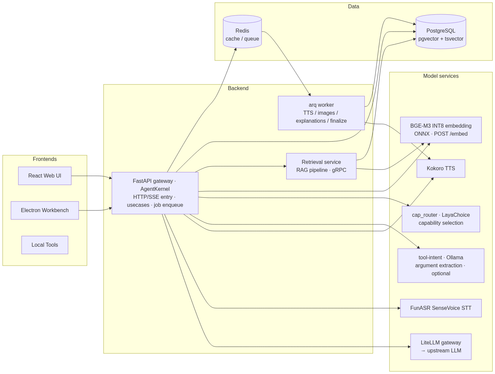

Mermaid source (for editing — regenerate via mermaid.ink)

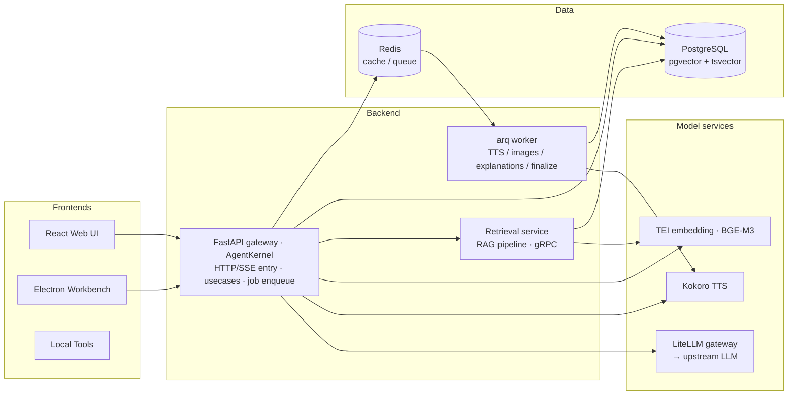

**Agent kernel** — the core, composed in and running inside the FastAPI gateway process:

Mermaid source (for editing — regenerate via mermaid.ink)

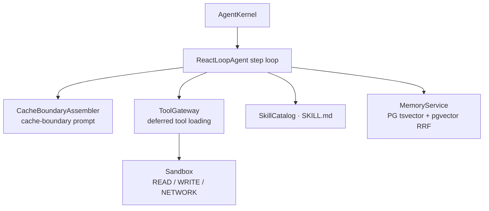

> Agent kernel — design: [architecture.md §5 Agent Module](architecture.md#5-agent-module).

**Answering flow** — each turn runs the `ReactLoopAgent` step loop, which decides what to retrieve and
composes the reply. It calls the **`rag_search` tool** (runs the RAG node pipeline and returns `top_k`
chunks — the retrieval layer described in the RAG section) and, only when local material is
insufficient, the **`web_search` tool** (duckduckgo / tavily / bing / google) for up-to-date external
results; it then composes the answer from both.

**Memory — two independent tracks, orchestrated by `MemoryService`** (writes go to the local
memdir, recall reads the database; the tracks never cross):

Mermaid source (for editing — regenerate via mermaid.ink)

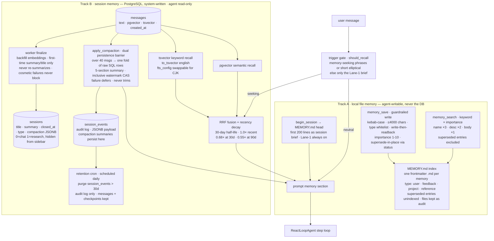

> **Memory invariants** — thinking is never persisted; `messages` are never deleted by compaction
> or retention; `memory_save` writes the memdir only (never the DB); a vector-channel failure
> degrades to tsvector-only (never a silent empty); superseding marks a memory `superseded` and
> keeps the file as an audit trail — it is never deleted; the recall gate skips only the deep
> recall on non-memory-seeking turns (the Lane-1 brief always injects); cosmetic failures
> (summary / title) never block the main flow; the session context rides the client's Live State,
> so a normal turn reads no SQL and a deferrable compaction never trims.
> Design: [architecture.md §5.4 — Memory, skills, sessions](architecture.md#54-memory-skills-sessions)
> and [§22 — Chat Session Memory v2](architecture.md#22-chat-session-memory-v2--client-live-state-authority--zero-read-turns).

**Prompt — cache-boundary assembly, compression, and deferred tool stubs** (architecture, design
features, and per-step process logic):

Mermaid source (for editing — regenerate via mermaid.ink)

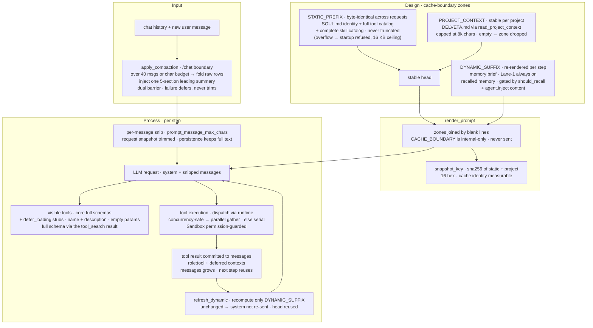

> **Prompt invariants** — the `CACHE_BOUNDARY` separator is internal-only and never rendered to the
> model; the stable head (STATIC_PREFIX + PROJECT_CONTEXT) is byte-identical across requests so the
> provider prefix cache is reused; only the DYNAMIC_SUFFIX re-renders per step and is skipped when
> unchanged; the per-message snip trims the request snapshot only, keeping the persistence copy raw;
> mounted tools appear as stable defer_loading stubs, with the full schema riding in the tool_search
> result.
> Design: [architecture.md §16 — Prompt Module](architecture.md#16-prompt-module).

**RAG & Query Repository — a config-driven, plug-and-play retrieval pipeline** over one unified search
corpus. A single query searches your cloud-drive files, Learning-Platform material, and chat Q&A
together. The pipeline's node list *is* the retrieval topology: compose, reorder, toggle, and tune every
stage from the admin console — live, no code, no restart. Feature walk-through in
[**Key Features**](docs/features.md); the design detail lives in
[§10 RAG Module (architecture.md)](architecture.md#10-rag-module-config-node-pipeline).

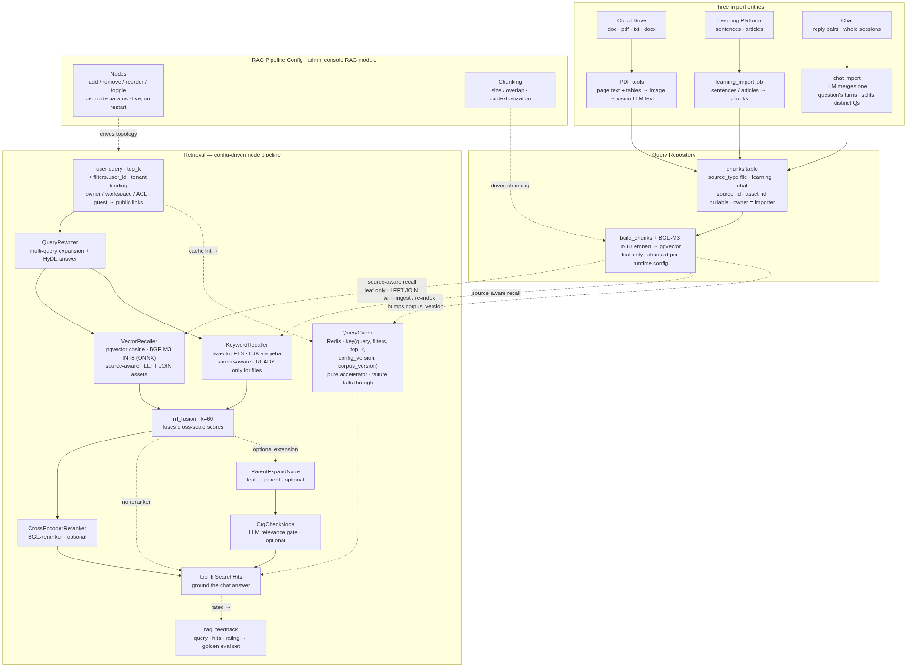

Mermaid source (for editing — regenerate via mermaid.ink)

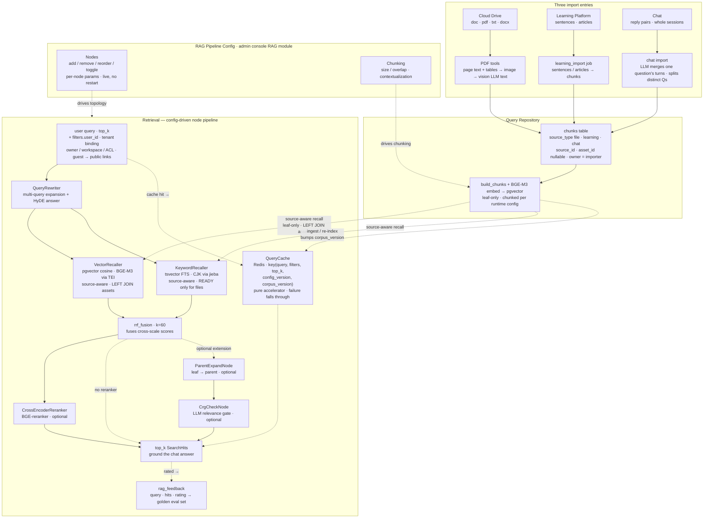

**Chat control plane — a turn's full path from transport to a terminal answer.**
`resolve_plan` keeps only the lifecycle: the pure L0 pass runs first, then a SINGLE
`intent_funnel.route()` call owns all routing (shadow hook + the Intent-Funnel
single-hop cascade — the legacy QIR lane was retired with migration 0014), and
`build_execution_plan` is the sole
policy mapper. Every PlanKind has a registered executor, every certified fast path
dispatches through the ONE shared execution waterfall, and every uncertifiable or
pre-commit-failing turn falls back to the Agent byte-identical. C1–C4 name the failure
classes (see the design section).

Mermaid source (for editing — regenerate via mermaid.ink)

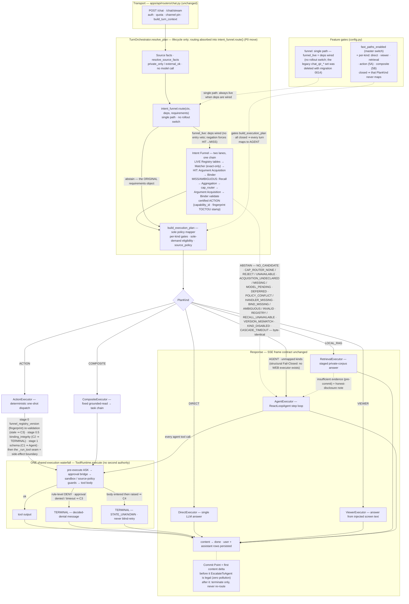

> **Chat control-plane invariants** — a fast path takes only turns it can certify, and its demand
> must be the *sole* demand; abstention leaves the user text byte-identical; the routing chain
> (Intent-Funnel cascade over the LIVE Registry tables) produces routing metadata only —
> capability + fingerprint stamp — and never executes or binds at the dispatch side; live-table
> writes are atomic text+embedding and the
> stamped fingerprint is re-validated before dispatch; C2/C3/C4 are terminal by contract — the
> Agent clarifies user incompleteness (C1) and is never the recovery channel for system faults,
> decided denials, or mid-write uncertainty.
> Design: [architecture.md §24 — Chat Control Plane](architecture.md#24-chat-control-plane--plan-resolution-fast-paths--intent-routing),
> [§25 — Chat Intent Funnel](architecture.md#25-chat-intent-funnel--nodeized-routing-selector--shared-tool-runtime).

**Intent Funnel — two lanes, one chain, end to end.** `funnel.route` runs inside plan
resolution: the LIVE Registry tables load first, and the Matcher consults the curated query
corpus only (exact). A HIT is already decided, so it goes straight to argument acquisition and is
never re-selected. Every non-HIT runs Recall (candidates only, no adjudication), Candidate
Aggregation, then exactly ONE `cap_router` selection call (the deployed LayaChoice service; its
stub is a test double only). The Argument Path Router then decides HOW the chosen capability's
arguments are acquired, and the Binder only validates against the Registry schema.
Every abstain, denial or fault exits fail-open to the Agent byte-identical; execution is
never the funnel's — a certified turn dispatches through the same shared waterfall.

Mermaid source (for editing — regenerate via mermaid.ink)

```mermaid
flowchart TB
    %% Invariants: the funnel produces routing metadata only · every abstain/fault returns the
    %% ORIGINAL TurnRequirements object (byte-identical, zero pollution) · a HIT is never
    %% re-selected · one selector hop on every MISS/AMBIGUOUS turn · an off-card id is never a verdict.

    USER["chat turn · resolve_plan →<br/>funnel.route(ctx, deps, requirements)"]

    subgraph lane[" "]
        direction LR
        subgraph entry["Entry — single path"]
            direction TB
            GATE["funnel_live = deps wired (no rollout switch · no entry veto)<br/>every wired turn reaches the Matcher;<br/>guardrails.negated forces a would-be HIT to MISS"]
        end
        USER --> GATE

        subgraph cascade["Two lanes, one chain (wall-clock budget chat_funnel_timeout_seconds)"]
            direction TB
            REG["LIVE Registry tables (capabilities + query rows) —<br/>the routing truth, fingerprint-cached; Recall corpus index<br/>loads on the MISS lane<br/>missing ⇒ REGISTRY_UNAVAILABLE / RECALL_UNAVAILABLE"]
            M["Node 1 · Matcher — EXACT-only over the live query corpus<br/>(enabled Standard + Similar rows; patterns/aliases are inert<br/>legacy storage, never read — ruling 2026-09-25)<br/>negation guard before certifying (common layer)<br/>HIT · MISS · MATCH_AMBIGUOUS (one sentence under two<br/>caps — all claimants up)"]
            R["Node 2 · Recall — TWO independent vector searches<br/>(Standard + Similar rows, ONE query embedding)<br/>every hit ≥ min_score kept with provenance — quality gate,<br/>no merge/dedup, never adjudicates (origin=recall)"]
            CAND["Candidate Aggregation — ONE card per capability_id<br/>matcher_ambiguous 0.0 rides alongside recall · EMPTY set<br/>short-circuits to NO_CANDIDATE, zero selector hops"]
            SEL["Node 3 · cap_router — the ONE production selector<br/>(deployed LayaChoice service: K cards + frozen REJECT)<br/>SELECTED · NONE · REJECT; unavailable / timeout /<br/>illegal label ⇒ CAP_ROUTER_UNAVAILABLE, never a<br/>second model"]
            ACQ["Node 4 · Argument Acquisition (Argument Path Router)<br/>CONTEXT_DIRECT · QUERY_TO_EXTRACTOR ·<br/>QUERY_PLUS_5TURNS_TO_EXTRACTOR · MIXED · MISSING<br/>the extractor fills ONLY MODEL-owned slots ·<br/>then the kind gate"]
            B["Binder.validate — pure schema gate<br/>Registry canonical parameters · extracts nothing<br/>COMPLETE / MISSING / AMBIGUOUS / INVALID<br/>(non-COMPLETE exits straight to the Agent, BIND_*)"]
            REG --> M
            M -- "any non-HIT: MISS / AMBIGUOUS" --> R --> CAND --> SEL
            M -- "HIT — never re-selected" --> ACQ
        end
        GATE --> REG
    end
    style lane fill:none,stroke:none

    subgraph exits["Fail-open exits — reason codes carry the stage prefix"]
        direction LR
        AG["Agent fallback — ReactLoopAgent, full autonomy<br/>original query BYTE-IDENTICAL · never a<br/>side effect precedes the fallback"]
        REASONS["REGISTRY_UNAVAILABLE · RECALL_TIMEOUT /<br/>UNAVAILABLE · NO_CANDIDATE (empty set, zero hops) ·<br/>CAP_ROUTER_NONE / REJECT / UNAVAILABLE / TIMEOUT ·<br/>INTENT_FUNNEL_ALLOWLIST_REJECT ·<br/>ACQUISITION_UNDECLARED /<br/>MISSING / MODEL_PENDING / DEFERRED /<br/>POLICY_CONFLICT / HANDLER_MISSING · REGISTRY_VERSION_MISMATCH ·<br/>FUNNEL_KIND_DISABLED · BIND_MISSING / AMBIGUOUS / INVALID ·<br/>CASCADE_TIMEOUT / CASCADE_ERROR"]
        REASONS -.- AG
    end
    SEL -- "NONE / REJECT" --> AG
    POST["post-decision gates (orchestrator.py, before acquisition):<br/>entry still in the active table? · capability admitted by the Intent Funnel?<br/>— missing entry ⇒ registry mismatch · not admitted ⇒ Intent Funnel allowlist<br/>reject, the turn falls open to the Agent"]
    SEL -- "SELECTED" --> POST
    POST -. "REGISTRY_VERSION_MISMATCH / INTENT_FUNNEL_ALLOWLIST_REJECT" .-> AG
    POST --> ACQ
    ACQ -- "not COMPLETE" --> AG
    ACQ --> B
    B -- "not COMPLETE" --> AG

    CERT["Certified ACTION turn — NEW TurnRequirements<br/>requested_action {tool, args, capability_id,<br/>funnel_registry_version = Registry fingerprint<br/>(the single TOCTOU stamp), funnel_stage, funnel_kind}"]
    B -- COMPLETE --> CERT
    CERT --> EX["ActionExecutor._dispatch — the funnel executed NOTHING,<br/>the plan stage owns this: TOCTOU re-validate the stamped<br/>fingerprint / active entry / same tool / kind still ON<br/>(drift ⇒ decided TERMINAL, never an Agent retry) ·<br/>binding_integrity marker ⇒ TERMINAL · validate_action<br/>schema gate — malformed ⇒ proven pre-body, Agent clarifies"]

    subgraph runtime["ONE shared execution waterfall — no second authority"]
        RW["runtime.execute stages (fail-closed each):<br/>tools/pre-execute (approval ASK · sandbox ·<br/>source-policy) → monotonic guard →<br/>tools/execute (tool body) → tools/post-execute<br/>→ events / audit"]
    end
    EX --> RW
    AG -- "every agent tool call" --> RW

    OBS["funnel_trace + session event row (execution_mode-tagged)<br/>deepest stage · matcher · recall top · cap_router verdict ·<br/>acquisition strategy · final route · per-stage latency"]
    B -.- OBS
```

> **Intent-Funnel invariants** — nodes speak only through `contract.py` structures; the Matcher
> holds zero hardcoded business rules (safety vetoes are funnel-common-layer code); Recall filters,
> never decides; a Matcher HIT is never re-selected; exactly ONE `cap_router` selection call per
> non-HIT turn, and a selector failure is an `Unavailable` exit to the Agent — never a second model
> and never a fabricated verdict; capability determination and argument acquisition are separate
> concerns, so Qwen runs only when the Argument Path Router chose a MODEL strategy; every
> non-COMPLETE outcome leaves the Agent's input byte-identical; the funnel executes nothing —
> certified and agent turns traverse the same waterfall.
> Design: [architecture.md §25 — Chat Intent Funnel](architecture.md#25-chat-intent-funnel--nodeized-routing-selector--shared-tool-runtime).

## Parameter-processing flow

**English.** The diagram is the complete path from the user's query to an executed
tool or an Agent fallback. It shows the decision points the implementation owns:
capability admission, the per-capability acquisition strategy, acquisition
failure, the Binder contract gate, and the execution boundary. Every "generate a
structured context block" node publishes the turn-scoped record described in
§25.8; the record is routing context only and never grants a capability.

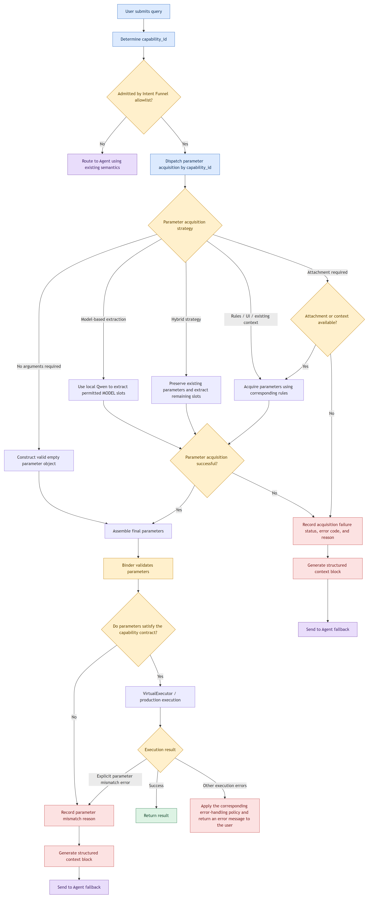

Mermaid source (for editing — regenerate via mermaid.ink)

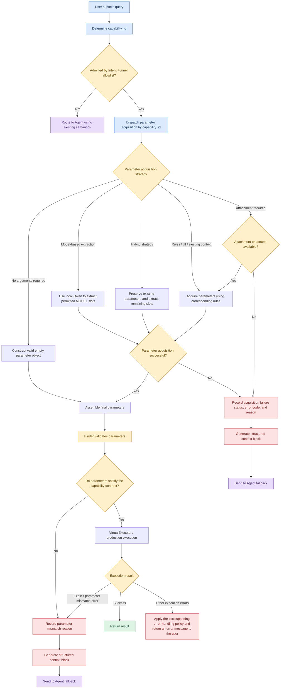

Reading the diagram against the code:

| Diagram node | Implementation |
|---|---|
| Determine `capability_id` | `intent_funnel/orchestrator.py::run_nodes` — Matcher HIT, or Recall → aggregation → cap_router |
| Admitted by the allowlist? | `registry/entry.py::is_intent_funnel_capability_allowed`; a reject publishes `ADMISSION_REJECT` |
| Dispatch by `capability_id` | `orchestrator.py::_acquisition_hop` reads `POLICIES` / `HANDLERS` by id — never infers from `parameters == {}` |
| Strategy branches | `NO_ARGS` / `RULE_CONTEXT` / `MIXED` / `MODEL` / `DEFERRED_AGENT` in `cap_handler/acquisition_policy.py` |
| Acquisition failed | `ACQUISITION_*` reason, kind `ACQUISITION_FAILURE`, stage `acquisition` |
| Binder gate | `binder.validate`; a miss publishes `CONTRACT_MISMATCH` at stage `binder` |
| Execution | `executors/action.py` — schema rejection publishes `CONTRACT_MISMATCH` at stage `executor`; a proven pre-body refusal publishes `EXECUTION_PREFLIGHT`; state-unknown is terminal and never replayed |
| Agent fallback | `publish_failure` → `turn_orchestrator.resolve_plan` → `AgentExecutor.run(context=…)` → `intent_funnel_reference` prompt section |

**中文。** 下图是从用户 query 到工具执行或 Agent 兜底的完整参数处理流程。图中保留了实现
真正拥有的决策点：能力准入、按 `capability_id` 分发的取参策略、取参失败、Binder 契约校验
以及执行边界。每个“生成结构化上下文信息块”节点都会发布 §25.8 描述的 turn 级记录；该记录
只是路由上下文，不授予任何能力。

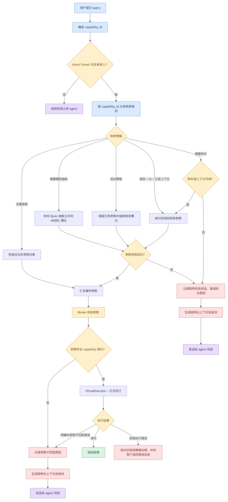

Mermaid source (for editing — regenerate via mermaid.ink)

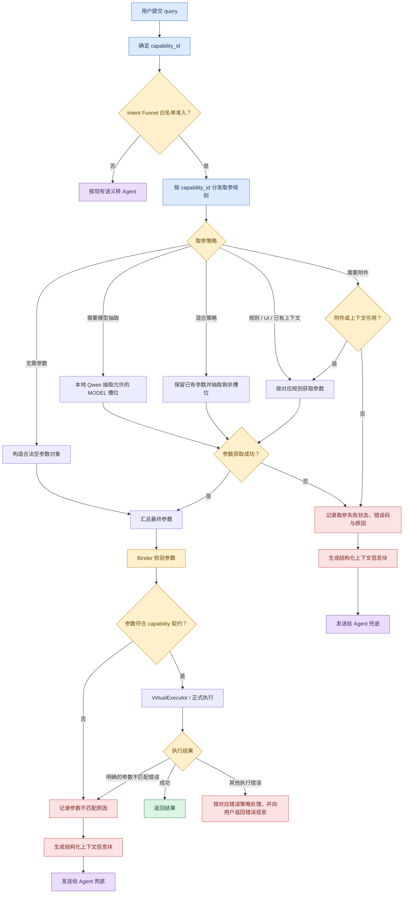

图中的节点与代码的对应关系：能力判定在 `run_nodes`（Matcher HIT，或 Recall → 聚合 →
cap_router）；准入判定是 `is_intent_funnel_capability_allowed`，拒绝时发布
`ADMISSION_REJECT`；取参分发在 `_acquisition_hop`，按 `capability_id` 读取 `POLICIES` /
`HANDLERS`，不从空参数推断策略；策略取值为 `NO_ARGS` / `RULE_CONTEXT` / `MIXED` /
`MODEL` / `DEFERRED_AGENT`；取参失败发布 `ACQUISITION_*`（kind `ACQUISITION_FAILURE`，
stage `acquisition`）；Binder 失败发布 `CONTRACT_MISMATCH`（stage `binder`）；执行器参数
门失败发布 `CONTRACT_MISMATCH`（stage `executor`），已证明未进入工具体的前置拒绝发布
`EXECUTION_PREFLIGHT`，执行状态未知则终止且绝不重放；结构化记录经
`turn_orchestrator.resolve_plan` 进入 `AgentExecutor.run(context=…)`，由
`intent_funnel_reference` 提示段落渲染。

> 说明：图中“规则 / UI / 已有上下文”对应第 1 类取参（确定性规则、Handler、可信上下文）。
> 文件类能力的 `pages` 不属于这一类，而是第 2 类的专用 `page_scope_resolver`（在线 LLM
> 只产出 `all` / `single` / `range`），由文件 Handler 在自己的 `acquire()` 内调用；非分页
> viewer 的跳过是 viewer kind 的结构化判断，不是用关键词规则替代模型分页语义。第 3 类是
> 共享 Qwen 抽取器。三类的职责边界、路由关系与失败处理见
> [phase4-acquisition-contract.md](phase4-acquisition-contract.md)。

> Design: [architecture.md §25.16 — Capability-Specific Acquisition Handlers](architecture.md#2516-capability-specific-acquisition-handlers).

> [architecture.md](architecture.md) is the single source of truth for the full design —
> tech stack, repository layout, agent-kernel internals, tool runtime, data model, and deployment
> topology (including what is implemented today vs. designed-only).

