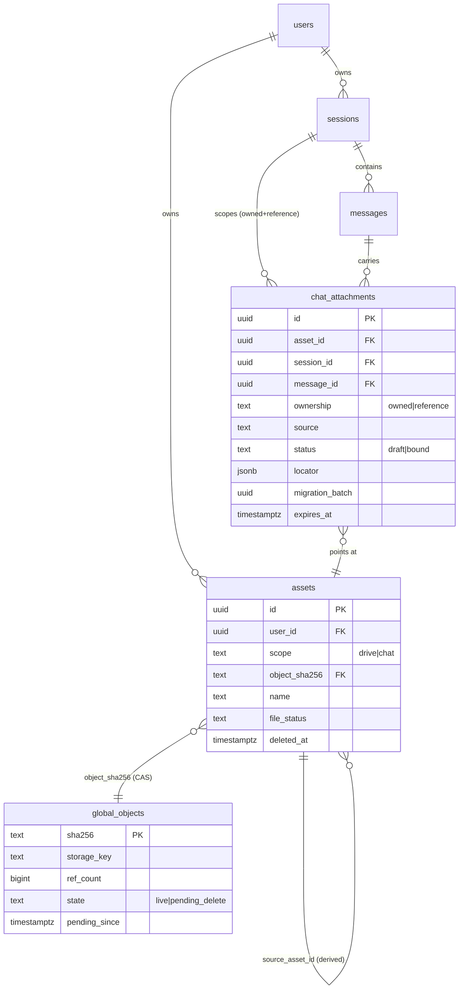
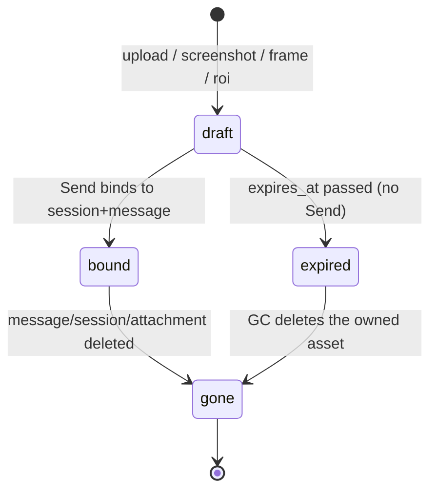
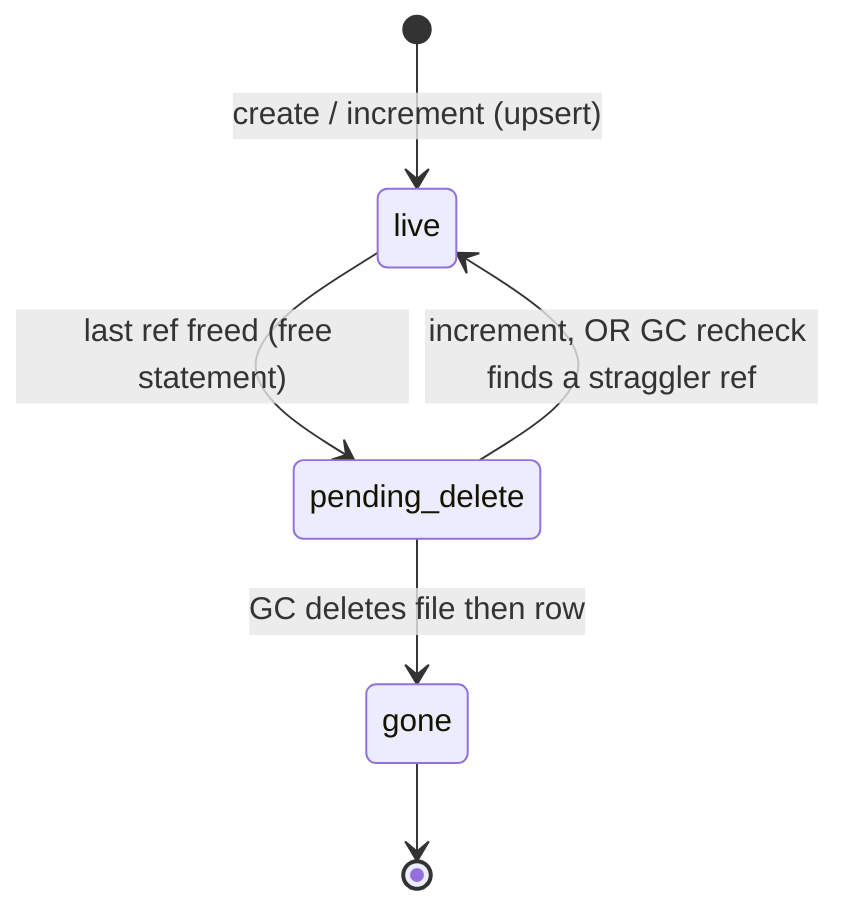

# Chat Assets — Design

Chat Assets are the documents, images, screenshots and video frame/region captures a user
attaches to a chat turn. They are stored in the **same physical content-addressed store as the
cloud drive** but are **invisible to the drive plane**: they never appear in Files / My Drive,
file search, the picker, or the trash, and they are not downloadable as drive files. They are
reachable **only through the chat Session they belong to**, and the isolation is enforced on the
server — not by hiding rows on the client and not by parking files in a magic folder.

This document is the design specification. It supersedes the `chat/temp` folder convention
(`apps/desktop/renderer/app.js` frame/roi upload) and the single-value
`messages.attach_asset_id` column.

> **Implementation status (as shipped).** This file is the *design*; the shipped code defers from
> the plan below in the ways listed here. Where a section still describes the plan, an
> **As shipped** note marks it — read that note first.
>
> - **Migration is one file, not two phases.** `migrations/0024_chat_assets.sql` shipped as a
>   **single** auto-applied file that does the additive DDL (`assets.scope`,
>   `global_objects.state` / `pending_since`, `CREATE TABLE chat_attachments` + indexes) **and**
>   the legacy carry plus `DROP COLUMN messages.attach_asset_id` in one transaction. There is no
>   `migrations/manual/0024b_*.sql`, no `migration_batch` column, no immutability triggers, and
>   no `app_settings` approval marker.
> - **No outbox.** `JobStore.create_in_tx` was not added. A crash between the logical free and
>   the physical collection is recovered by the periodic sweeper (§9.7), not by a persisted job.
> - **One sweeper.** The shipped GC is the `chat_asset_gc` arq cron (`apps/worker/tasks.py`,
>   schedule `23 * * * *`, `run_at_startup=True`), which calls
>   `ChatAssetService.gc(grace_seconds=chat_asset_gc_grace_seconds)` = `draft_gc` →
>   `assets.purge_deleted_chat_assets` → `objects.sweep_pending`. There are no separate
>   `chat_draft_gc` / `object_file_gc` named jobs. Success and failure are logged; a raised
>   exception is retried by arq.
> - **Shipped as designed.** `assets.scope` (§3.1), `global_objects.state` / `pending_since`
>   (§9.2), `chat_attachments` minus `migration_batch` (§3.2), the visibility predicate (§5),
>   the draft→bind flow (§6), viewer frame/roi persistence (§7), the double-check read (§4), and
>   the CAS invariants (§9.4).
> - **Retired.** The `chat/temp` folder convention and the `messages.attach_asset_id` column are
>   gone; 0024 drops the column. (The client still sends an `attach` object in the message body —
>   that is transport, resolved through `chat_attachments`, not the column.)
> - **Tests.** 14 fake-backed tests (`tests/test_chat_assets.py`) and 8 real-PostgreSQL
>   integration tests (`tests/test_chat_assets_integration.py`).

## 0. Terminology

> **As shipped:** the 阶段 A / Phase 1 / 阶段 B split below was not used — see the box above.
> There is one migration file, `0024_chat_assets.sql`, applied automatically by the runner.

The words "stage A"/"stage B" are overloaded; this document uses the following exact names.

| Name | Meaning | Applies DDL? | Gate |
|---|---|---|---|
| **阶段 A — Pre-migration audit** | Read-only audit of the target DB | no (SELECT only) | run freely |
| **Phase 1 — additive migration** (`migrations/0024_chat_assets.sql`) | Pure-add DDL (new column/table/index) | yes, additive only | auto-run by the runner |
| **阶段 B — destructive migration** (`migrations/manual/0024b_*.sql`) | Per-row backfill + column drop | yes, destructive | human approval after 阶段 A |

阶段 A never changes data. Phase 1 never changes existing rows. 阶段 B is the only destructive
step and requires an explicit approval (§10.2).

---

## 1. Goals and non-goals

Goals:

- Reuse `assets`, `global_objects` (SHA-256 CAS), `asset_acl`, chunked upload and download —
  one physical store, no second blob store.
- A chat asset is **owned** by exactly one Session and isolated to its owner.
- A chat can also **reference** a normal drive file (open a PDF in the viewer, ask about it)
  without copying it; deleting the chat must never touch that drive file.
- One Session → many attachments; one Message → many attachments.
- Viewer **Frame / ROI** captures are persisted as chat assets, restored when the session is
  reopened, and readable by `VisionHandler` only after authorization.
- Predictable deletion: delete Session / delete Message / delete one attachment.
- A GC that is reliable and idempotent: no lost jobs, no double `ref_count` decrement, no
  deleting a still-referenced physical object, and an orphan sweep.

Non-goals:

- Deduplicating chat assets across users for privacy (CAS sharing at the object layer is
  already how the drive works; the *logical* asset stays per-user).
- Cross-session sharing of a chat asset (that is what drive files + ACL are for).
- A new blob store, a new upload protocol, or client-side-only hiding.

---

## 2. Design principles

1. **CAS stays untouched.** Bytes live in `global_objects` — one row per SHA-256, ref-counted,
   `storage_key = objects/{sha[0:2]}/{sha[2:4]}/{sha}`. Chat assets are new *logical* rows
   pointing at the same objects.
2. **Visibility is a security dimension, not a UI category.** Hiding chat assets is enforced by
   the same predicate mechanism that already enforces tenancy, expressed once for the ORM and
   once for raw SQL. A `folder_path` string or an untyped `meta` flag cannot be the boundary.
3. **Authority is a dedicated table.** `chat_attachments` — not `messages.attach_asset_id`,
   not `assets.meta` — is the single source of truth for "this asset belongs to this chat".
4. **Ownership is double-validated.** Every read re-checks both the `chat_attachments` row and
   the underlying asset's scope/ownership. Either check failing → not found.
5. **Deletion is app-driven and counted.** FKs cascade rows; `ref_count` changes are made only
   by code that runs inside a defined transaction, never implicitly.
6. **The durable state is the outbox.** Physical-object retirement is driven by a persisted
   state on `global_objects`, so a crash between "logically freed" and "physically removed" is
   recovered by a sweeper rather than lost. **As shipped:** the persisting *state* is
   `global_objects.state='pending_delete'` + `pending_since`; no separate outbox job row was
   added — the recovery path is the periodic `chat_asset_gc` sweep (§9.7).

---

## 3. Data model

### 3.1 `assets.scope` — the visibility dimension

Add one column:

```sql
ALTER TABLE assets ADD COLUMN scope text NOT NULL DEFAULT 'drive';
ALTER TABLE assets ADD CONSTRAINT assets_scope_check CHECK (scope IN ('drive','chat'));
CREATE INDEX assets_chat_owner_idx ON assets(user_id) WHERE scope = 'chat';
```

- `scope='drive'` — a normal drive file (default; every existing row).
- `scope='chat'` — a chat-only asset, hidden from the entire drive plane.

`scope` is deliberately **not** `folder_path='chat/temp'` and **not** an `assets.category` UI
label. It is the discriminator the visibility predicate keys on (§5), so it must be a typed,
indexed, NOT NULL column with a CHECK — properties a free-text folder path and a `meta` jsonb
key do not have. The owner channel of the current predicate is unconditional
([visibility.py:57-66](../../packages/core/infrastructure/visibility.py#L57)), so an owner would
otherwise always see their own chat assets in Files; `scope` is what removes them.

### 3.2 `chat_attachments` — the authority

> **As shipped:** the table matches this design **except** the `migration_batch` column and its
> `chat_attach_batch_idx` index, which were not created (no 阶段 B backfill path was used). Every
> other column, the `chat_attach_bound_needs_session` CHECK, and the session / message / asset /
> draft indexes shipped as written.

```sql
CREATE TABLE chat_attachments (
    id              uuid PRIMARY KEY DEFAULT gen_random_uuid(),
    asset_id        uuid NOT NULL REFERENCES assets(id)   ON DELETE CASCADE,
    user_id         uuid NOT NULL REFERENCES users(id)    ON DELETE CASCADE,
    session_id      uuid          REFERENCES sessions(id) ON DELETE CASCADE,  -- NULL while draft
    message_id      uuid          REFERENCES messages(id) ON DELETE CASCADE,  -- NULL while draft
    ownership       text NOT NULL DEFAULT 'owned'
                    CHECK (ownership IN ('owned','reference')),
    source          text NOT NULL DEFAULT 'upload'
                    CHECK (source IN ('upload','screenshot','frame','roi','viewer')),
    status          text NOT NULL DEFAULT 'draft'
                    CHECK (status IN ('draft','bound')),
    locator         jsonb NOT NULL DEFAULT '{}'::jsonb,  -- frame/roi/page coordinates
    migration_batch uuid,                                -- NULL = native; set = 阶段 B backfill
    created_at      timestamptz NOT NULL DEFAULT now(),
    bound_at        timestamptz,
    expires_at      timestamptz,                          -- set while draft
    CONSTRAINT chat_attach_bound_needs_session
        CHECK (status = 'draft' OR session_id IS NOT NULL)
);

CREATE INDEX chat_attach_session_idx ON chat_attachments(session_id) WHERE session_id IS NOT NULL;
CREATE INDEX chat_attach_message_idx ON chat_attachments(message_id) WHERE message_id IS NOT NULL;
CREATE INDEX chat_attach_asset_idx   ON chat_attachments(asset_id);
CREATE INDEX chat_attach_draft_idx   ON chat_attachments(expires_at) WHERE status = 'draft';
CREATE INDEX chat_attach_batch_idx   ON chat_attachments(migration_batch)
    WHERE migration_batch IS NOT NULL;
```

Field notes:

- `ownership`
  - `owned` — the asset was created for this chat (`assets.scope='chat'`). Deleting the chat
    deletes the asset.
  - `reference` — the asset is a normal drive file (`assets.scope='drive'`), merely mounted into
    the chat (a viewer payload, a `＋` pick of an existing file). Deleting the chat removes only
    the `chat_attachments` row; the drive file is untouched.
- `source` — provenance for the acquiring capability (`cap-vision` for `frame`/`roi`,
  `cap-read-document` for `viewer`, etc.).
- `locator` — for `frame`/`roi`: `{"t_ms":…, "x":…, "y":…, "w":…, "h":…}`; for a document page:
  `{"page":…}`. This replaces the transient selection that is currently dropped on persist.
- `status` — `draft` before the turn is sent (session may be `NULL`), `bound` after Send.
- `migration_batch` — discriminates rows written by a 阶段 B backfill from native rows; `NULL`
  for every row the application creates. It is the anchor for the §10.3 bijection proof.
  **Not shipped** — the column and its index were dropped from the final table (see the box above).
- No `ordinal` column: attachment order within a message is carried by the payload array order
  the client sends; the table is a set, not an ordered list.

### 3.3 Relationship diagram

> **As shipped:** the `chat_attachments` box shows `migration_batch`, which was **not** created
> (see §3.2). Everything else — `assets.scope`, `chat_attachments`, `global_objects.state` /
> `pending_since` — shipped as drawn.



### 3.4 Why not the existing columns

| Candidate | Verdict | Reason |
|---|---|---|
| `messages.attach_asset_id` | **retire** | Single-valued (1:1), so it cannot express N attachments per message; it has no place for `ownership`/`source`/`locator`; and it carries four unrelated duties at once. |
| `assets.folder_path='chat/temp'` | **retire** | Free-text, unindexed, and not a security boundary — the owner channel would still expose it, and a re-parented file would escape. |
| `assets.meta` jsonb | reject | Untyped, no index, no raw-SQL twin, and — per the read-only audit — **currently unused** across all 60 dev assets, so there is no precedent to build on. |

The four duties currently bundled into `attach_asset_id` all move to `chat_attachments`:

1. **Delete-locate** — `delete_session` / `delete_session_message` query `chat_attachments`
   instead of `MessageModel.attach_asset_id`.
2. **Reopen-display** — session detail reads `chat_attachments` joined to `assets`.
3. **RAG-copy** — the `cap-read-document` screenshot copy is keyed off the `chat_attachments`
   row of the source message.
4. **Ownership** — `ownership` + `assets.scope` replace the implicit "whatever the message
   points at".

---

## 4. Ownership and isolation

- **Owned chat asset**: `chat_attachments.ownership='owned'`, `assets.scope='chat'`,
  `assets.user_id = <owner>`. Created by upload/screenshot/frame/roi. Isolated to its Session.
- **Reference attachment**: `chat_attachments.ownership='reference'`, `assets.scope='drive'`.
  The drive file already belongs to (or is shared with) the user via owner/workspace/ACL.

Every read of a chat asset performs **two** checks and fails closed:

1. a `chat_attachments` row exists for `(asset_id, session_id)` and the session is owned by the
   caller; and
2. for `owned`: `assets.scope='chat' AND assets.user_id = caller`;
   for `reference`: `asset_visible_expr(caller)` holds (owner / workspace / ACL) **at read
   time**, so a revoked ACL revokes chat access too.

A `reference` asset is **never** copied and **never** deleted by chat GC. Mounting a drive file
into a chat (`ownership='reference'`) is a pure link: one new `chat_attachments` row.

---

## 5. Visibility and authorization

### 5.1 Drive-plane exclusion

The shared predicate gains a scope term, in both twins:

```python
# visibility.py — asset_visible_expr
return and_(
    AssetModel.scope == "drive",
    or_(AssetModel.user_id == user_id,
        AssetModel.workspace_id.in_(_visible_workspaces(user_id)),
        AssetModel.id.in_(acl_ok)),
)
```

and the raw twin `asset_visibility_sql` gets the same `a.scope = 'drive'` guard on the joined
asset. This is the single change that hides chat assets from Files, `/files` listing, file
search, the picker, trash, and download — everywhere the predicate is already applied. It must
be applied consistently: any drive endpoint that resolves an asset by id (get / download /
content / move / copy / share / import-rag / delete) must additionally reject
`scope='chat'` with **404** (never 403 — do not confirm existence on the drive plane).

### 5.2 Session-plane access

Chat assets are read through the session, not the drive:

- Session reopen: `load_session_detail` joins `chat_attachments → assets` (scoped to the
  session) instead of the `attach_asset_id` LEFT JOIN it uses today
  ([memory.py:1010](../../packages/core/infrastructure/memory.py#L1010)).
- Attachment download: `GET /sessions/{id}/attachments/{attachment_id}/content` — authorizes on
  session ownership, then streams the object. No drive-plane route serves a `scope='chat'` asset.
- VisionHandler resolves a frame/roi's image through the `chat_attachments` row (§7), not
  through a drive download.

### 5.3 Authorization matrix

| Caller | Owned chat asset | Reference drive file | Normal drive file |
|---|---|---|---|
| Owner via session plane | allow | allow while ACL holds | allow |
| Owner via drive plane | **404** | allow | allow |
| Another user via session plane | 404 | 404 | n/a |
| Another user with ACL via drive plane | 404 | allow | allow |

---

## 6. Draft → bind flow

Uploads happen before Send, and the turn may be abandoned. The lifecycle:



1. **Draft create** (upload / screenshot / frame / roi): create the `assets` row with
   `scope='chat'`, upload bytes to CAS, and insert a `chat_attachments` row with
   `status='draft'`, `session_id=NULL`, `message_id=NULL`, `expires_at = now() + interval
   '24 hours'`.
2. **Bind on Send**: in the same transaction that persists the user message, set the batched
   attachment rows to `status='bound'`, `session_id`, `message_id`, `bound_at=now()`,
   `expires_at=NULL`. A message with N attachments writes N rows. The client sends an array of
   draft/asset ids; unknown or unbound-to-this-user ids are rejected.
3. **Reference mount**: a viewer payload (`meta.viewer.asset_id`, currently persisted on
   assistant messages — 76 dev messages reference 2 drive assets) or a `＋`-picked drive file
   becomes a `chat_attachments` row with `ownership='reference'`, `session_id`/`message_id` set
   at Send. It creates **no** new asset.
4. **Temp-chunk cleanup**: `upload_sessions` rows for abandoned drafts are reaped with their
   draft (the existing upload flow already has an `upload_sessions` table).

---

## 7. Viewer Frame / ROI persistence and restore

Before this change (old scheme), a frame/roi was captured client-side, uploaded to `chat/temp`
as a *drive-visible* screenshot, and its id is passed as `ViewerSelection.image_asset_id`
([schemas.py:151](../../apps/api/schemas.py#L151)). Two defects follow: the asset is
drive-visible, and the persisted `viewer_snapshot`
([viewer_context.py:510](../../apps/api/viewer_context.py#L510)) **drops** `image_asset_id`
(only `selection_count` is kept), so a reopened session cannot restore or re-run vision.

Design:

- Frame/roi capture uploads with `scope='chat'`, `source='frame'|'roi'`, and a `chat_attachments`
  row carrying `locator={t_ms,x,y,w,h}`. It is never `chat/temp`.
- `viewer_snapshot` keeps `image_asset_id` (and the locator) so a reopened session restores the
  capture.
- `VisionHandler` resolves the image via the `chat_attachments` row for the message, after the
  §4 double check. This closes the currently open gap where a selection-backed image is
  unreachable (the handler reads `attachment_asset_id → path_asset_id → viewer_asset_id` only;
  `TurnFacts` has no field for a selection's `image_asset_id`).

---

## 8. Deletion semantics

Rule of thumb: **owned assets are counted and freed; reference links are dropped, never
followed.**

- **Delete a Session**: cascade-delete its `messages` and `session_events`; cascade-delete its
  `chat_attachments` (via `session_id` FK). Then, for every cascaded row with
  `ownership='owned'`, run the counted asset free (§9.3). Reference rows free nothing.
  Drafts belonging to the session (if any) are freed the same way.
- **Delete a single Message**: cascade-delete its `chat_attachments` (via `message_id`);
  free owned assets, drop reference links.
- **Delete a single Attachment**: delete that `chat_attachments` row; if `owned`, free the
  asset; if `reference`, drop only the link. One asset may have several links (a frame reused
  across turns) — only its last link frees it.

Ordering (lock, collect, verify, logical delete, GC enqueue — one transaction):

1. `SELECT … FROM chat_attachments WHERE session_id=… FOR UPDATE` (or the message-scoped set).
2. Collect the distinct owned `asset_id`s; `SELECT … FROM assets WHERE id = ANY(…) FOR UPDATE`.
3. Verify each owned asset is `scope='chat'` and owned by the caller; any mismatch aborts the
   whole delete (no partial teardown).
4. Logical delete: soft-delete the assets (`deleted_at=now()`), delete the `chat_attachments`
   rows, delete the session/message. Each owned free runs the guarded ref-count decrement of
   §9.3 (note: this takes the row atomicity of the decrement, **not** the per-SHA advisory
   lock — see §9.0).
5. In the **same transaction**, write the physical-GC job row for each freed object
   (`JobStore.create_in_tx`) so the outbox is atomic with the logical delete, then commit.
   **As shipped:** step 5 was not implemented. `_retire_owned_asset` does the guarded ref-count
   free only; the physical object is reclaimed later by the hourly `chat_asset_gc` sweep (§9.7),
   which is what recovers a crash between the logical free and the physical delete.

FKs (`messages.session_id`, `chat_attachments.session_id`, `chat_attachments.message_id`,
`chat_attachments.asset_id`) are `ON DELETE CASCADE` and act as the safety net; the app path
performs the counted free explicitly so `ref_count` stays truthful.

---

## 9. CAS object lifecycle, locking, and GC

### 9.0 Lock domains (reconciling "all transitions lock" vs "deletion locks nothing")

Two logically different locks are involved. The design uses each for exactly one purpose, and
the earlier "all state changes take the advisory lock / asset deletion takes no lock" phrasing
conflated them. The precise rule:

| Lock | Mechanism | Scope | Released | Serializes |
|---|---|---|---|---|
| **Row lock** | `SELECT … FOR UPDATE`, plus single-statement UPDATE atomicity | one DB transaction | `COMMIT`/`ROLLBACK` | `ref_count`/`state` arithmetic on the same `global_objects` row |
| **Physical-op lock** (advisory) | `pg_advisory_lock(hashtextextended(sha,0))` | one session, explicit unlock | `pg_advisory_unlock` | the *file* operation by a reviving create/increment against GC |

Rule:

- **Advisory-lock holders are exactly two operations**: (a) upload **create/increment** (any
  path that can move an object to `live`), and (b) **physical GC**. Nothing else takes it.
- **Logical asset deletion (the free / decrement) takes NO advisory lock.** It is a guarded
  single-statement UPDATE (row-atomic) that may flip an object to `pending_delete`; it never
  touches the file. The exclusive physical work is *deferred* to GC, which rechecks under the
  lock. So "deletion takes no lock" is true of the **advisory** lock and false of the **row**
  lock — the free statement is itself a row-atomic operation.
- **Row locks** are taken inside GC's critical section (`FOR UPDATE` on the `global_objects`
  row) and by the drive/session delete when it collects `assets` rows `FOR UPDATE`.

### 9.1 Why the advisory lock must span the file op (a row lock cannot)

A row lock is released at `COMMIT`, but the physical file op is not transactional. If the file
delete were inside the DB transaction, a crash after the delete but before `COMMIT` would roll
the row back to `live` while the file is already gone — a live object with a missing file. So
the file op must run **outside** any transaction, and only a lock that outlives the transaction
(the advisory lock) can serialize a concurrent revive against it.

### 9.2 Object state machine

Add to `global_objects` (Phase 1):

```sql
ALTER TABLE global_objects ADD COLUMN state text NOT NULL DEFAULT 'live'
    CHECK (state IN ('live','pending_delete'));
ALTER TABLE global_objects ADD COLUMN pending_since timestamptz;
CREATE INDEX global_objects_pending_idx ON global_objects(pending_since)
    WHERE state = 'pending_delete';
```



### 9.3 Transaction boundaries and ordering, per operation

**(1) Upload create / increment — advisory lock held; file written first.**
```
pg_advisory_lock( h(sha) )
    storage.put(objects/<sha>, bytes)          # idempotent; MUST precede the live transition
    BEGIN
      INSERT INTO global_objects(sha,size,storage_key,mime_type,ref_count,state)
        VALUES (:sha,:size,:key,:mime,1,'live')
      ON CONFLICT (sha) DO UPDATE SET
        ref_count     = global_objects.ref_count + 1,
        state         = 'live',
        pending_since = NULL
    COMMIT
pg_advisory_unlock( h(sha) )
```

**(2) Free (logical asset/attachment delete) — NO advisory lock; row atomicity + outbox.**
> **As shipped:** the `JobStore.create_in_tx(...)` line below was **not** written — the guarded
> `UPDATE` is the whole operation, and the hourly sweep (§9.7) does the physical reclamation.
```
BEGIN
  UPDATE global_objects SET
      ref_count     = ref_count - 1,
      state         = CASE WHEN ref_count - 1 <= 0 THEN 'pending_delete' ELSE state END,
      pending_since = CASE WHEN ref_count - 1 <= 0 THEN now() ELSE pending_since END
   WHERE sha256 = :sha AND ref_count > 0
  RETURNING ref_count, state;                 # row-atomic; concurrent frees serialize here
  < soft/hard delete assets rows; delete chat_attachments rows >
  JobStore.create_in_tx(session, 'object_file_gc', {...})   # outbox, same tx
COMMIT
```

**(3) Physical GC — advisory lock held; file op outside the tx.**
```
pg_advisory_lock( h(sha) )
    BEGIN                                      # tx A: decide, under the lock
      SELECT ref_count, state FROM global_objects WHERE sha256=:sha FOR UPDATE
        -> no row                      : nothing to collect
        -> state <> 'pending_delete'
           OR ref_count > 0            : skip (revived / still referenced)
        -> EXISTS(assets WHERE object_sha256=:sha):
             UPDATE global_objects SET state='live', pending_since=NULL WHERE sha256=:sha
             skip                          # revert: a straggler reference survives
    COMMIT                                     # row lock released; advisory lock STILL held
    storage.delete(storage_key)                # idempotent; outside the tx
    DELETE FROM global_objects WHERE sha256=:sha AND state='pending_delete'  # guarded
pg_advisory_unlock( h(sha) )
```

**(4) Revive** — two paths, both under the advisory lock: path 1 = increment's `ON CONFLICT …
state='live'`; path 2 = GC's tx-A recheck reverting a straggler.

**(5) Sweep** — identical to (3), selecting `state='pending_delete' AND pending_since < now() -
grace`; it is also the recovery path for a GC job whose arq delivery was lost.

### 9.4 Invariants and preconditions

Preconditions (must hold for the proofs):

- **P1** every create/increment writes the object bytes (`storage.put`) **before** the live
  transition; there is no "dedup skip the put".
- **P2** the free statement is the only writer that decrements `ref_count`, and it is guarded
  `ref_count > 0`.
- **P3** GC deletes the file **before** it deletes the row.
- **P4** one advisory key, `hashtextextended(sha,0)`, used by both create/increment and GC.
- **P5** `storage.put` and `storage.delete` are idempotent for a given key.
- **P6** GC's tx A runs after acquiring the lock, so it reads a committed `ref_count`/`state`.
- **P7** the sweep grace window ≥ the maximum GC critical-section duration (the advisory lock
  already prevents overlap; grace only avoids redundant sweeps).

**Invariant A — `state='live'` ⇒ the file exists.**
The file is deleted only in GC's critical section, which requires the lock. Every transition to
`live` (create/increment/revive) also requires the lock, so the two are serialized:
- transition-to-live *before* GC: GC's recheck sees `ref_count>0` or a referencing asset ⇒ skip;
  file untouched.
- GC *before* transition-to-live: GC removes file+row; the later create runs `storage.put`
  (P1) before `INSERT` ⇒ file re-created. A later revive only happens via increment (which
  re-puts) or via GC's own revert (which does not delete). Hence no live row without a file.

**Invariant B — GC never deletes a still-referenced object.**
GC deletes the row only if, under the lock, `state='pending_delete' AND ref_count<=0 AND NOT
EXISTS(assets)`. A concurrent increment cannot run (advisory lock). A concurrent free only
lowers `ref_count`. The FK `assets.object_sha256 → global_objects(sha256) ON DELETE NO ACTION`
makes the row `DELETE` fail closed if any asset references it, even if the recheck were wrong.

**Invariant C — revive ⟂ physical-delete (mutual exclusion).**
Both acquire `pg_advisory_lock(h(sha))` and so cannot overlap. Any interleaving reduces to the
two serial orders of Invariant A; the recheck reads committed state (P6), so it never observes
a half-applied revive.

**Invariant D — crash recovery (file-first ordering).**
Enumerate the GC crash points:
- before tx A commits: row unchanged; sweep re-runs. Safe.
- after tx A commit, before `storage.delete`: row `pending_delete`, file present; sweep
  re-runs and collects. Safe (file-preserved-until-collected).
- after `storage.delete`, before row DELETE: row `pending_delete`, file absent; sweep
  re-deletes the file (idempotent no-op, P5) then deletes the row. Safe.
- during the row DELETE before COMMIT: rollback ⇒ row `pending_delete`; sweep recovers. Safe.
No crash point yields a live row with no file, nor a `ref_count>0` object marked for
collection. Every step is idempotent: `storage.delete`, the guarded row `DELETE`, and the whole
GC are safe to replay.

### 9.5 Concurrency verification (risky interleavings, resolved)

| # | Interleaving | Without the lock | With the protocol |
|---|---|---|---|
| I1 | create (same sha) ∥ GC | GC deletes file; create's `INSERT` makes row live, file missing → **breaks A** | serialized: create-then-GC ⇒ GC skips; GC-then-create ⇒ create re-puts (P1) |
| I2 | free (2→1→0) ∥ GC | GC reads stale 0, deletes while ref 1 survives → **breaks B** | GC tx A `FOR UPDATE` reads committed count; free is row-atomic (P2) |
| I3 | revive ∥ GC file-delete | revive sets live while file is being removed → **breaks A/C** | both need the advisory lock ⇒ mutually exclusive (C) |
| I4 | GC crash after file delete | row left live-but-fileless (if file op were in-tx) | file op is outside the tx + file-first (P3) ⇒ sweep clears (D) |
| I5 | two GC jobs for one sha | double `storage.delete` / double row-delete | advisory lock serializes; both ops idempotent (P5) |

### 9.6 Reconciliation as a safety net

Because the read-only audit found `ref_count` drift (two dev objects at `ref_count=18` against 8
asset rows each), GC must not trust `ref_count` as the sole reference signal: the physical GC
rechecks actual `assets` rows (§9.3). A low-frequency reconciliation job reports (never
auto-corrects) objects whose `ref_count` disagrees with the count of referencing asset rows.

**As shipped:** the recheck-under-the-lock is in place (`SqlGlobalObjectRepository.collect`
counts referencing `assets` rows before deleting). No separate low-frequency
reconciliation/reporting job was added. `tests/test_chat_assets_integration.py` proves the
recheck refuses to collect an object a live asset still references.

### 9.7 Sweepers

> **As shipped:** there is **one** periodic arq job, not two. `chat_asset_gc`
> (`apps/worker/tasks.py`, schedule `23 * * * *`, `run_at_startup=True`) calls
> `ChatAssetService.gc(grace_seconds=chat_asset_gc_grace_seconds)` and runs all three phases in
> order: (1) reap expired draft `chat_attachments` (`draft_gc`), (2) `purge_deleted_chat_assets`
> for tombstones past the grace window, (3) `sweep_pending` for `global_objects` in
> `pending_delete` past the grace window. It logs success (`drafts` / `assets_reaped` /
> `objects`) and, on failure, logs and re-raises so arq retries. `JobStore.create_in_tx` was
> **not** added.

Two periodic, idempotent arq jobs (design — superseded, see the note above):

1. `chat_draft_gc` — `chat_attachments WHERE status='draft' AND expires_at < now()`: free owned
   assets via §9.3, delete the rows, reap the matching `upload_sessions`.
2. `object_file_gc` sweep — `global_objects WHERE state='pending_delete' AND pending_since <
   now() - grace`: re-run §9.3 physical GC (also the recovery path for a lost job).

Add `JobStore.create_in_tx(session, type_, payload, user_id)`, because the existing
`JobStore.create` ([jobs.py:47-55](../../packages/core/infrastructure/jobs.py#L47)) opens its
**own** session and cannot join the caller's transaction.

---

## 10. Migration

> **As shipped (supersedes §10.1–§10.5):** `migrations/0024_chat_assets.sql` is a **single** file
> the runner applies automatically, in one `BEGIN … COMMIT`, doing all of:
> (1) `assets.scope` + CHECK + partial index; (2) `global_objects.state` / `pending_since` +
> CHECK + partial index; (3) `CREATE TABLE chat_attachments` (without `migration_batch`) + the
> session / message / asset / draft indexes; (4) a guarded `DO` block that carries classifiable
> legacy `messages.attach_asset_id` rows into `chat_attachments` (aborting atomically on a
> missing / soft-deleted / cross-user asset) and then drops the column, its index, and its FK.
> There is no `migrations/manual/0024b_*.sql`, no 阶段 A/B gate, no approval marker, no
> `migration_batch` bijection, and no immutability triggers. 0001 still declares the pre-0024
> `messages.attach_asset_id`; 0024 removes it. Proof: `tests/test_chat_assets_integration.py`.

### 10.1 Phase 1 — additive, auto-applied (`migrations/0024_chat_assets.sql`)

Non-destructive only, every statement `IF NOT EXISTS`-guarded:

1. `assets.scope` column + CHECK + partial index.
2. `global_objects.state` / `pending_since` + CHECK + partial index.
3. `CREATE TABLE chat_attachments` (incl. `migration_batch`) + indexes.

Every existing asset stays `scope='drive'`; every object stays `state='live'`. **No row is
moved, deleted, or rewritten.**

### 10.2 Approval gate — verified against the real runner

Facts verified in the current tree:

- The **only** migration runner is `init_db()`
  ([db.py:1148](../../packages/core/infrastructure/db.py#L1148)), invoked from
  `apps/api/main.py:87` (FastAPI lifespan) and `scripts/init_db.py`.
- It iterates `sorted(_MIGRATIONS_DIR.glob("*.sql"))` — **non-recursive**
  ([db.py:1169](../../packages/core/infrastructure/db.py#L1169)) — so `migrations/manual/*.sql`
  is **never** auto-applied. No code path reads that directory.
- Each file runs inside `async with conn.transaction()`
  ([db.py:1174](../../packages/core/infrastructure/db.py#L1174)); on success the version (file
  stem) is inserted into `schema_migrations`.
- There is **no checksum**: an already-recorded version is skipped by stem, so editing an
  applied file is a silent no-op (matches the repo's migration-immutability rule).

**Re-application behavior:** re-running `0024` is a no-op (recorded version) and, even if not
recorded, all its DDL is `IF NOT EXISTS`-guarded ⇒ safe. `0024b` is not tracked by the runner;
it guards itself: `IF NOT EXISTS (SELECT 1 FROM information_schema.columns WHERE
table_name='messages' AND column_name='attach_asset_id') THEN <do work>` — a second run finds
the column gone and does nothing.

**Approval marker.** `0024b` begins with a guard that aborts unless the marker is present:

```sql
DO $$ BEGIN
  IF NOT EXISTS (
    SELECT 1 FROM app_settings
     WHERE key = 'chat_assets.cleanup_approved'
       AND value->>'approved' = 'true'
       AND value->>'audit_sha' IS NOT NULL
       AND value->>'batch' IS NOT NULL
  ) THEN
    RAISE EXCEPTION '阶段 B not approved: missing app_settings chat_assets.cleanup_approved';
  END IF;
END $$;
```

**Authorization boundary — stated honestly.** The marker is a *safety interlock and intent
record*, not an access-control system. It (a) makes `0024b` fail closed on a fresh or CI DB,
and (b) binds the run to a specific audited state via `audit_sha` (the hash of the 阶段 A
report). Real authorization is **operational**: the file sits outside the runner, and a human
executes it after approving the 阶段 A report. Anyone holding DDL rights can run it; the marker
only proves the operator declared intent against a known audit.

**Rollback scope.** `0024b` wraps the entire body in one `BEGIN … COMMIT`; any `RAISE
EXCEPTION` (marker missing, unclassifiable row, any bijection check failing) aborts the whole
file — no partial backfill, no column drop. This mirrors the runner's own per-file transaction
semantics.

**Unknown-ownership / unclassifiable records abort.** §10.3 rule S2 raises and rolls back; the
migration never guesses or silently drops.

### 10.3 阶段 B backfill — bidirectional bijection with per-row SQL

The backfill moves links, not bytes. Its acceptance is a **bidirectional, key-level bijection**,
not a total-count or `EXISTS` check. Discriminator: every row inserted by the run is tagged with
a run-unique `migration_batch`; native rows have `migration_batch IS NULL`.

`0024b` (single transaction; every guard raises on failure ⇒ whole-file rollback):

```sql
BEGIN;
SET LOCAL chat_assets.batch = :'batch';        -- run-unique uuid

-- S1  snapshot the legacy source and the pre-existing native rows
CREATE TEMP TABLE _legacy ON COMMIT DROP AS
  SELECT m.id AS message_id, m.session_id, m.user_id, m.attach_asset_id AS asset_id
  FROM messages m WHERE m.attach_asset_id IS NOT NULL;
CREATE TEMP TABLE _preexisting ON COMMIT DROP AS SELECT id FROM chat_attachments;

-- S2  classify; any unclassifiable legacy row aborts (never guess, never drop)
DO $$ DECLARE n int; BEGIN
  SELECT count(*) INTO n
  FROM _legacy l LEFT JOIN assets a ON a.id = l.asset_id
  WHERE a.id IS NULL                                   -- R1 asset missing
     OR a.deleted_at IS NOT NULL                        -- soft-deleted target
     OR a.user_id <> l.user_id                          -- R2/R5 owner mismatch
     OR a.scope NOT IN ('drive','chat');                -- unknown scope
  IF n > 0 THEN RAISE EXCEPTION '阶段 B aborted: % unclassifiable legacy rows', n; END IF;
END $$;

-- S3  insert exactly one new attachment per legacy row, tagged with the batch
INSERT INTO chat_attachments
  (asset_id, user_id, session_id, message_id, ownership, source, status, migration_batch, bound_at)
SELECT l.asset_id, l.user_id, l.session_id, l.message_id,
       CASE WHEN a.scope = 'chat' THEN 'owned' ELSE 'reference' END,
       'viewer', 'bound', current_setting('chat_assets.batch')::uuid, now()
FROM _legacy l JOIN assets a ON a.id = l.asset_id;

-- S4  FORWARD: every legacy row ↔ exactly ONE new batch row (all 5 keys equal)
DO $$ DECLARE n int; BEGIN
  SELECT count(*) INTO n FROM (
    SELECT l.message_id
    FROM _legacy l
    LEFT JOIN chat_attachments ca
      ON ca.migration_batch = current_setting('chat_assets.batch')::uuid
     AND ca.message_id = l.message_id AND ca.asset_id   = l.asset_id
     AND ca.session_id = l.session_id AND ca.user_id    = l.user_id
    GROUP BY l.message_id HAVING count(ca.id) <> 1
  ) x;
  IF n > 0 THEN RAISE EXCEPTION 'forward bijection failed on % rows', n; END IF;
END $$;

-- S5  BACKWARD: every new batch row ↔ exactly ONE legacy row (all 5 keys equal)
DO $$ DECLARE n int; BEGIN
  SELECT count(*) INTO n FROM (
    SELECT ca.id
    FROM chat_attachments ca
    LEFT JOIN _legacy l
      ON l.message_id = ca.message_id AND l.asset_id   = ca.asset_id
     AND l.session_id = ca.session_id AND l.user_id    = ca.user_id
    WHERE ca.migration_batch = current_setting('chat_assets.batch')::uuid
    GROUP BY ca.id HAVING count(l.message_id) <> 1
  ) x;
  IF n > 0 THEN RAISE EXCEPTION 'backward bijection failed on % rows', n; END IF;
END $$;

-- S6  new vs pre-existing are disjoint; no native row lost its tag
DO $$ DECLARE n int; BEGIN
  SELECT count(*) INTO n FROM chat_attachments
   WHERE migration_batch = current_setting('chat_assets.batch')::uuid
     AND id IN (SELECT id FROM _preexisting);
  IF n > 0 THEN RAISE EXCEPTION 'batch overwrote % native rows', n; END IF;
  SELECT count(*) INTO n FROM chat_attachments
   WHERE migration_batch IS NULL AND id NOT IN (SELECT id FROM _preexisting);
  IF n > 0 THEN RAISE EXCEPTION '% rows lost their native tag', n; END IF;
END $$;

-- S7  ownership classification correctness (no wrongful upgrade to owned)
DO $$ DECLARE n int; BEGIN
  SELECT count(*) INTO n
  FROM chat_attachments ca JOIN assets a ON a.id = ca.asset_id
  WHERE ca.migration_batch = current_setting('chat_assets.batch')::uuid
    AND ca.ownership <> CASE WHEN a.scope = 'chat' THEN 'owned' ELSE 'reference' END;
  IF n > 0 THEN RAISE EXCEPTION 'ownership misclassified on % rows', n; END IF;
END $$;

-- S8  reachability set equality (user, session, asset) pre vs post
DO $$ DECLARE n int; BEGIN
  SELECT count(*) INTO n FROM (
    (SELECT user_id, session_id, asset_id FROM _legacy
     EXCEPT
     SELECT user_id, session_id, asset_id FROM chat_attachments
      WHERE migration_batch = current_setting('chat_assets.batch')::uuid)
    UNION ALL
    (SELECT user_id, session_id, asset_id FROM chat_attachments
      WHERE migration_batch = current_setting('chat_assets.batch')::uuid
     EXCEPT
     SELECT user_id, session_id, asset_id FROM _legacy)
  ) x;
  IF n > 0 THEN RAISE EXCEPTION 'reachability set mismatch on % triples', n; END IF;
END $$;

-- S9  the backfill moved links, not bytes: ref_count sanity only
DO $$ DECLARE n int; BEGIN
  SELECT count(*) INTO n FROM global_objects WHERE ref_count < 0;
  IF n > 0 THEN RAISE EXCEPTION 'ref_count went negative'; END IF;
END $$;

-- S10  only after every check passes: drop the deprecated column
ALTER TABLE messages DROP CONSTRAINT messages_attach_asset_id_fkey;
DROP INDEX idx_messages_attach_asset;
ALTER TABLE messages DROP COLUMN attach_asset_id;
COMMIT;
```

Rule mapping (revised R1–R8):

- **R1** every legacy reference resolves to an existing asset (S2).
- **R2** the asset belongs to the same user as the referencing session/message (S2).
- **R3** forward bijection — every legacy row matches exactly one new row on
  `message_id, asset_id, session_id, user_id` (S4).
- **R4** backward bijection — every new row matches exactly one legacy row on the same five keys
  (S5). Together with R3 this is a true bijection, not a count.
- **R5** `ownership` is derived from the asset's scope (`chat`→`owned`, `drive`→`reference`)
  and re-verified (S7); a wrongful `owned` upgrade aborts.
- **R6** the reachable `(user, session, asset)` set is identical before and after (S8).
- **R7** new vs pre-existing rows are provably disjoint and no native row is re-tagged (S6).
- **R8** unclassifiable rows (missing/deleted/foreign/re-scoped assets) abort the whole
  migration (S2); the backfill never guesses or silently drops.

### 10.4 Immutability guard — a global DB invariant

The `(session_id, message_id, user_id)` identity of a chat row must never move after insert, so
the `chat_attachments` attribution can never be re-pointed by a stray update. This is a **global
database invariant change** and is treated as such.

Confirmed against the current tree — **no legitimate flow updates these columns**:

| Flow | What it updates | Touches identity? |
|---|---|---|
| Compaction | `sessions SET compaction, summary` ([memory.py:150,158](../../packages/core/infrastructure/memory.py#L150)) | no |
| Import / RAG backfill | `messages SET imported_rag` ([tasks.py:1116](../../apps/worker/tasks.py#L1116), [sessions.py:78](../../apps/api/routers/sessions.py#L78)) | no |
| Reconcile | `messages` INSERT / DELETE / UPDATE `text, embedding` ([memory.py:reconcile_messages](packages/core/infrastructure/memory.py)) | no |
| Delete | `DELETE` (FK cascade) | n/a (delete, not update) |

Proposed guards (Phase 1, `WHEN (OLD IS DISTINCT FROM NEW …)` so a no-op self-assignment is
allowed and ORM full-row updates are unaffected):

```sql
CREATE FUNCTION assert_identity_immutable() RETURNS trigger AS $$
BEGIN
  IF TG_TABLE_NAME = 'sessions'  AND NEW.user_id    IS DISTINCT FROM OLD.user_id    THEN
    RAISE EXCEPTION 'sessions.user_id is immutable';
  ELSIF TG_TABLE_NAME = 'messages' THEN
    IF NEW.user_id IS DISTINCT FROM OLD.user_id OR
       NEW.session_id IS DISTINCT FROM OLD.session_id THEN
      RAISE EXCEPTION 'messages identity is immutable';
    END IF;
  END IF;
  RETURN NEW;
END $$ LANGUAGE plpgsql;

CREATE TRIGGER sessions_identity_immutable BEFORE UPDATE ON sessions
  FOR EACH ROW EXECUTE FUNCTION assert_identity_immutable();
CREATE TRIGGER messages_identity_immutable BEFORE UPDATE ON messages
  FOR EACH ROW EXECUTE FUNCTION assert_identity_immutable();
```

Impact review: imports insert (no trigger fire) and set only `imported_rag`; rebuild/reconcile
inserts/deletes and updates only `text,embedding`; delete cascades (DELETE); compaction updates
only `compaction,summary`. None is blocked. The trigger **would** block a future "move a message
to another session" or "re-attribute a session" feature — those must re-insert rather than
mutate, which is the intended invariant. This change is additive and reversible (drop the
triggers).

### 10.5 Fresh-install consideration

`0001_init.sql` is the canonical pg_dump-based install and still defines
`messages.attach_asset_id`. A fresh install runs `0001` (column present) then `0024b` (which,
once approved, drops it). To keep fresh installs consistent without forcing `0024b`, the
long-term step is to fold the final state into `0001` (a squash of the post-阶段-B schema), per
the file's own instruction ("extend this schema instead"). **Precondition for any `0024b`
approval:** decide whether the column drop also lands in `0001`; until then a fresh install
retains the deprecated column and `0024b` is the only path that removes it.

**As shipped:** a fresh install runs `0001` … `0024` in order; `0024` (auto-applied, not a
separate manual `0024b`) carries the classifiable legacy rows and drops the column in the same
file, so a fresh install never retains it. `tests/test_chat_assets_integration.py` asserts the
full chain applies and `messages.attach_asset_id` is gone afterwards. Folding the final state
back into `0001` remains an open cleanup item (§14).

---

## 11. 阶段 A — read-only audit

### 11.1 Scope

Run against the environment under review (dev DB first), before any `0024b` authoring/approval.
It answers: how much legacy surface is there, is it classifiable, and what are the risks.

Query set:

- `messages.attach_asset_id`: non-null count, distinct count, duplicates, orphans (asset
  missing), soft-deleted targets, cross-user targets, targets still in `chat/temp`.
- chat-ish assets: rows with `folder_path LIKE 'chat/%'`; assets reachable only through a chat.
- attribution: each candidate's user vs its session/message owner.
- CAS reconciliation: `global_objects.ref_count` vs count of referencing `assets` rows; orphan
  objects (no referencing asset); objects shared by >1 asset.
- other references into candidate assets: `assets.source_asset_id` (derived), RAG-derived
  images, `asset_acl` rows, `messages.meta->'viewer'->>'asset_id'`.
- unclassifiable rows, each with a reason.
- recommendation: migrate vs keep-as-is, with risks.

### 11.2 How SELECT-only is guaranteed (technically, not just by convention)

1. **Read-only transaction** — every query runs inside `BEGIN TRANSACTION READ ONLY; … ROLLBACK;`.
   Postgres rejects any INSERT/UPDATE/DELETE/DDL in a read-only transaction with
   `ERROR: cannot execute … in a read-only transaction`, so a mistake cannot write.
2. **Read-only role (defense in depth)** — connect as a role holding only `SELECT` privileges on
   the audited schemas, so even an out-of-transaction slip fails.
3. **Session flags** — `SET default_transaction_read_only = on; SET statement_timeout = '…';`
   at connect time.
4. **Pure SQL, no blob access** — the audit never calls `storage.put` / `storage.delete`; it
   touches the database only, never the filesystem or object store.
5. **Statement shape** — only `SELECT` / `WITH … SELECT`; no `DO`, `CALL`, `TRUNCATE`, `ALTER`,
   `CREATE` (temp tables are permitted in a read-only tx but avoided; CTEs are used instead).
6. **No persistence** — results print to stdout; nothing is written back to the DB, and the
   explicit `ROLLBACK` discards the transaction regardless of outcome.

---

## 12. Deprecations

> **As shipped:** both deprecations are complete. `0024` carried the classifiable legacy
> `messages.attach_asset_id` rows into `chat_attachments` and dropped the column, its index, and
> its FK; the client now uploads chat attachments as `scope='chat'` assets via
> `POST /sessions/attachments` (no `chat/temp` folder). The code comments that once still said
> `chat/temp` when they meant the owned chat asset have since been corrected.

- **`assets.folder_path='chat/temp'` convention** — deprecated. Frame/roi captures move to
  `scope='chat'` chat assets. Kept only long enough to let the audit find any stragglers; target
  removal once 阶段 B is approved.
- **`messages.attach_asset_id`** — deprecated in favour of `chat_attachments`. Its column,
  index and FK are dropped in 阶段 B. Until then it is frozen: no new writes.
- The client `uploadBytesToCloud(..., folder_path='chat/temp')` path
  ([app.js:5237](../../apps/desktop/renderer/app.js#L5237)) is replaced by a chat-asset upload
  that sets `scope='chat'`.

Each deprecation is declared with why (single-value / not a security boundary), its replacement
(`chat_attachments` + `assets.scope`), the migration path (Phase 1 then 阶段 B), and the removal
milestone (阶段 B approval).

---

## 13. Test matrix

> **As shipped:** the visibility / session-read / reference / draft / bind / delete / CAS rows
> below are covered by `tests/test_chat_assets.py` (14 fake-backed) and
> `tests/test_chat_assets_integration.py` (8 real-PostgreSQL). The **Phase 1 / 阶段 B / Immutability**
> rows describe the un-shipped two-phase plan (see §10) and have no counterpart in the shipped
> code.

| Area | Case | Expectation |
|---|---|---|
| Visibility | owner lists `/files` with a chat asset present | chat asset absent |
| Visibility | owner GETs chat asset on drive plane | 404 |
| Visibility | another user GETs chat asset on drive plane | 404 |
| Visibility | file search / picker | chat asset absent |
| Session read | owner reopens session | all attachments present, in order |
| Reference | ACL revoked after mount, then session read | reference attachment not returned |
| Reference | delete session | drive file untouched; link gone |
| Draft | upload then abandon, 24h passes | draft + owned asset + upload_session reaped |
| Bind | send message with N attachments | N bound rows; correct session/message |
| Delete | delete message | owned assets freed; reference links dropped only |
| Delete | delete one of several links to one asset | asset freed only at last link |
| Delete | crash mid-delete (after logical delete, before commit) | nothing partially removed on retry |
| CAS I1 | create(same sha) ∥ GC | serialized; file never missing while `live` |
| CAS I2 | free(2→1→0) ∥ GC | GC skips if a ref survives; never breaks Invariant B |
| CAS I3 | revive ∥ GC file-delete | mutually exclusive via advisory lock |
| CAS I4 | GC crash after file delete, before row delete | sweep reclaims; no live-without-file |
| CAS I5 | replay GC job | no-op; no double decrement |
| CAS | object referenced by 2 assets, free one | `ref_count=1`, object retained |
| CAS | FK protection | delete attempted while asset references → fails closed |
| Vision | frame/roi capture | `scope='chat'`, `source='frame'|'roi'`, locator stored |
| Vision | reopen session, re-run vision | handler resolves image via attachment, authorized |
| Migration | Phase 1 on populated DB | additive only; all assets `scope='drive'` |
| Migration | 阶段 B without approval marker | abort |
| Migration | 阶段 B forward bijection (S4) | every legacy row ↔ exactly one new row |
| Migration | 阶段 B backward bijection (S5) | every new row ↔ exactly one legacy row |
| Migration | 阶段 B unclassifiable row | abort + full rollback (S2) |
| Migration | 阶段 B ownership upgrade attempt | abort (S7) |
| Migration | 阶段 B re-run after drop | no-op (column gone) |
| Immutability | UPDATE sessions.user_id / messages.session_id | rejected by trigger |
| Immutability | compaction / import / reconcile | unaffected |

---

## 14. Open decisions

> **As shipped:** (1) draft TTL is the code default `86400s`; (3) `scope` stayed a closed
> `drive | chat` enum; (7) the sweep grace is `chat_asset_gc_grace_seconds = 3600s`. Items (5)
> and (6) are moot — there is no 阶段 B and no immutability trigger in the shipped code. Items
> (2) and (4) remain genuinely open.

1. **Draft TTL** — proposed 24h. Confirm the window and whether abandoned drafts survive a
   client restart.
2. **Session-scoped vs message-scoped attachments** — can an attachment exist at session level
   with no message? Current design allows `message_id NULL` while `bound`; confirm reachable.
3. **`scope` beyond `drive`/`chat`** — keep the enum closed for now.
4. **Reconciliation policy** — report-only (proposed) vs auto-correct for `ref_count` drift.
5. **阶段 B timing and the `0001` squash** — whether the column drop also lands in the canonical
   `0001_init.sql` (§10.5).
6. **Immutability guard rollout** — land the triggers in Phase 1 (§10.4), or defer to a separate
   change since it is a global invariant, not chat-asset-local.
7. **Sweep grace window** — the concrete value for `pending_since < now() - grace` (§9.7).

---

## 15. Appendix — current-state evidence

- `assets` has no `scope`; the visibility predicate's owner channel is unconditional
  ([visibility.py:57-66](../../packages/core/infrastructure/visibility.py#L57)).
- `messages.attach_asset_id` is single-valued with a `ON DELETE SET NULL` FK
  ([0001_init.sql:310,1459](../../migrations/0001_init.sql#L310)).
- `_purge_asset` decrements, then deletes the row, then retires the object across three
  independent transactions ([drive_service.py:473-497](../../packages/core/application/drive_service.py#L473)).
- `assets.object_sha256 → global_objects(sha256)` is `ON DELETE NO ACTION` — the DB already
  refuses to retire an object while an asset references it
  ([0001_init.sql:1323](../../migrations/0001_init.sql#L1323)).
- `JobStore.create` opens its own session ([jobs.py:47-55](../../packages/core/infrastructure/jobs.py#L47)).
- `viewer_snapshot` drops `image_asset_id` ([viewer_context.py:510](../../apps/api/viewer_context.py#L510)).
- The only migration runner is `init_db()`, globbing `migrations/*.sql` non-recursively
  ([db.py:1148,1169](../../packages/core/infrastructure/db.py#L1148)).
- No code updates `sessions.user_id` / `messages.user_id` / `messages.session_id`; the only
  UPDATEs are `sessions{compaction,summary}` and `messages{imported_rag,text,embedding}`.
