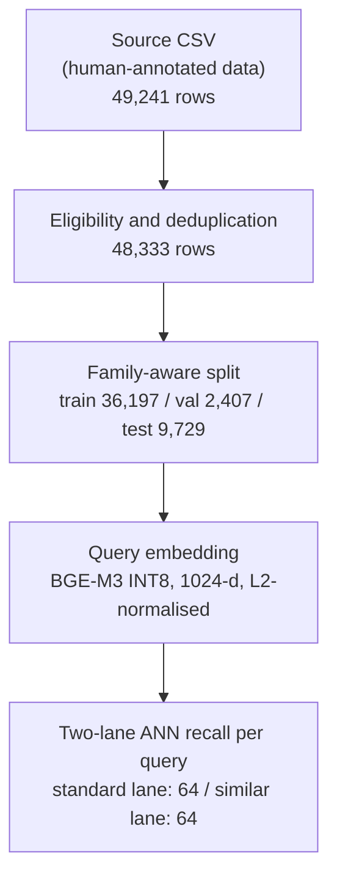
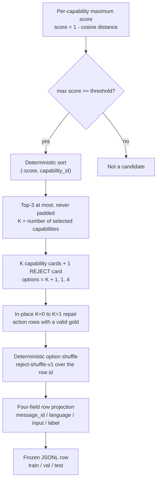

> **Dataset:** [eric-ml-nlp/Delveta-LayaChoice-v2-Data](https://huggingface.co/datasets/eric-ml-nlp/Delveta-LayaChoice-v2-Data)
>
> This directory contains documentation, not the data bundles. Download the JSONL
> files from the dataset repository above.

# Delveta LayaChoice-v2 Data

## 1. Dataset Overview

LayaChoice-v2 is a multiple-choice dataset for **capability selection**: given a user
request and a set of candidate capability cards, choose the card that should handle the
request, or choose the single `REJECT` card when no candidate is correct.

The dataset is built for fine-tuning and evaluating a Laya-style non-autoregressive
decision model. Each question contains:

- a user request (`input.query`);
- `K` real recalled capability cards, where `K` is 0 to 3;
- exactly one frozen `REJECT` card.

Therefore every row has `K + 1` options (1 to 4). The option count is dynamic; the fixed
constant `OPTION_SLOTS = 4` is only the upper bound used by the training adapter. `REJECT`
is a real option, not a threshold or a post-hoc rule.

The default configuration is `recall_threshold_082`, the bundle used for formal training.
Two historical thresholds, `recall_threshold_085` and `recall_threshold_088`, are archived
under `data_versions/`. All three versions share the same source rows, the same split
assignment and one shared recall pass; they differ in the similarity threshold that decides
which capabilities become candidates.

| | |
|---|---|
| Task | Pick one of K capability cards plus one `REJECT` card |
| Rows per version | 48,333 (train 36,197 / validation 2,407 / test 9,729) |
| Versions | threshold 0.82 (default), 0.85, 0.88 |
| Capabilities | 18 |
| Languages | `en` 22,053 / `zh` 20,667 / `mixed` 5,613 |
| Option count | 1 to 4 (`K + 1`) |
| Training rows | 36,197, of which 400 are held out for calibration |
| Effective gradient rows | 35,797 |
| Card view | `B_noprov` (production card without query examples and provenance) |

## 2. Dataset Structure

```text
Delveta-LayaChoice-v2-Data/
├── README.md
├── DATASET_SCHEMA.md
├── SHA256SUMS
├── train.jsonl                  # default: recall_threshold_082
├── val.jsonl
├── test.jsonl
├── manifest.json
└── data_versions/
    ├── README.md
    ├── recall_threshold_085/
    │   ├── train.jsonl
    │   ├── val.jsonl
    │   ├── test.jsonl
    │   ├── manifest.json
    │   └── SHA256SUMS
    └── recall_threshold_088/
        ├── train.jsonl
        ├── val.jsonl
        ├── test.jsonl
        ├── manifest.json
        └── SHA256SUMS
```

The root files are the default `recall_threshold_082` bundle. Each historical directory is
an independent, self-contained bundle with its own JSONL files, manifest and checksums.
See [DATASET_SCHEMA.md](DATASET_SCHEMA.md) for the complete field contract and validation
rules, and [data_versions/README.md](data_versions/README.md) for provenance and version
verification.

The JSONL split file names are `train.jsonl`, `val.jsonl` and `test.jsonl`. In the Hugging
Face configuration above, `val.jsonl` is exposed as the `validation` split.

### Bundle sizes

Sizes are computed from the shipped bytes in decimal units (1 MB = 1,000,000 bytes).

| Version | `train.jsonl` | `val.jsonl` | `test.jsonl` | `manifest.json` | Total |
|---|---:|---:|---:|---:|---:|
| 0.82 (root) | 69.01 MB | 4.64 MB | 18.64 MB | 0.71 MB | 93.00 MB |
| 0.85 | 54.63 MB | 3.62 MB | 14.73 MB | 0.71 MB | 73.69 MB |
| 0.88 | 47.45 MB | 3.16 MB | 12.81 MB | 0.71 MB | 64.13 MB |

## 3. Dataset Schema

Every row is a four-key record. Only `input` (`query` + `options`) and `label` are training
fields; `message_id` and `language` are metadata. The split is not stored in the row; the
containing file name is the authority.

| Key | Type | Present in every row | Used to build model input / target | Meaning |
|---|---|---|---|---|
| `message_id` | string | yes | no — metadata only | Canonical uuid4 sample id, unique within the bundle |
| `language` | string | yes | no — metadata only | Resolved language: `en`, `zh` or `mixed` |
| `input` | object | yes | yes — model input | Model input container; exactly `query` and `options` |
| `label` | integer | yes | yes — scalar class index | 0-based index of the correct option in `input.options`; the selected option maps to a capability ID or `REJECT`. |

All four keys are present in every row, but only `input` and `label` participate in
training. `message_id` and `language` are metadata: they never enter the model input, the
target or calibration.

`input` has exactly two keys, both used by the model:

| Key | Type | Present in every row | Used to build model input / target | Meaning |
|---|---|---|---|---|
| `input.query` | string | yes | yes — request segment | The user request shown to the model |
| `input.options` | list[string] | yes | yes — one `[MASK]` slot each | The exact option texts, in stored option order |

Each option string is `"<capability_id>: <card>"`, except that an empty card is the bare
capability id. The `REJECT` option is `"REJECT: <frozen reject card>"`.

Two invariants hold for every row:

1. `input.options` has 1 to 4 entries and contains exactly one option whose id is `REJECT`.
2. `0 <= label < len(input.options)`.

For a capability row, the option at `label` is a capability card. For a `REJECT` row, the
option at `label` is the `REJECT` card. The stored option order is the **shuffled** order;
it does not encode retrieval rank.

`message_id` is a fresh uuid4 in every threshold bundle and is unique within a bundle. It is
sample metadata: it never enters the model input, the target or calibration.

### 3.1 Adapter view

The training adapter derives three values from `input`:

| Derived value | Source |
|---|---|
| `order` | capability id of each option, in stored option order |
| `options` | card text of each option (the part after `"<id>: "`) |
| `gold_index` | `label` |

`target_kind`, `gold_capability_id` and `reject_index` are derived properties of those
values. They are not stored in a row.

### 3.2 Fields used by training

| Row field | Use |
|---|---|
| `input.query` | Appended to the model input as the request segment |
| `input.options` | Each option is prefixed with one `[MASK]` marker and placed in the head |
| `label` | Scalar class index over the row's actual option slots; expanded at training time to a one-hot vector (length K+1) |
| `message_id` | Metadata only; not model input, not target |
| `language` | Metadata only; not model input, not target |

The instruction is not a row field. It comes from `manifest.instructions`
(`Which capability should handle the user's request?`), read at render time.

### 3.3 Final model input

The renderer builds one flat token sequence per row:

```text
[CLS] choice question: <instructions> [SEP]
        [MASK] <option 0> [MASK] <option 1> ... [SEP]
        <query> [SEP]
```

- `[CLS]`, `[SEP]` and `[MASK]` are the base model's special tokens.
- `input.options` are emitted in their stored order, one `[MASK]` marker per option.
- `input.query` is appended after the option block.
- `label` never appears in the sequence. It is stored as an integer slot index and expanded
  at training time into a one-hot vector over the row's actual option slots (length K+1,
  1–4). This is **not** a global 0–17 capability-class one-hot vector.

For the row in §6.7 (`K = 2`, `label = 0`), the sequence is:

```text
[CLS] choice question: Which capability should handle the user's request? [SEP]
[MASK] cap-translate: ### cap-translate … [MASK] cap-pdf-extract-text: ### cap-pdf-extract-text … [MASK] REJECT: ### REJECT … [SEP]
Can you say “Labels must be supported by the original sentence. Please confirm whether the final output preserves every citation.” in Chinese? [SEP]
```

The `…` shortens the card bodies; the stored option strings are used verbatim. `label = 0`
selects the first `[MASK]` slot.

Budget: each option's text is capped at 256 tokens (the `[MASK]` marker is additional), the
question head and all options share 768 tokens, and the whole sequence is capped at 1024
tokens. No padding is added when the sequence is shorter than the cap.

## 4. Dataset Splits

| Split | Rows | Share | `en` | `zh` | `mixed` | Type |
|---|---:|---:|---:|---:|---:|---|
| train | 36,197 | 74.89% | 16,499 | 15,505 | 4,193 | gradient training; 400 held out for calibration |
| val | 2,407 | 4.98% | 1,116 | 1,030 | 261 | checkpoint selection |
| test | 9,729 | 20.13% | 4,438 | 4,132 | 1,159 | final benchmark only |
| total | 48,333 | 100% | 22,053 | 20,667 | 5,613 | |

Splits are stratified by source gold label × resolved language and allocated with
family-aware indivisible units. The target is about 75/20/5, with minimum representation for
small groups:

- group size 1: all rows in train;
- group size 2: one train, one test;
- group size 3 or more: at least one validation and one test row, converging to 75/20/5 for
  large groups.

Source gold label and resolved language define the strata; rows from the same query family
never cross splits. One split assignment is computed once and reused by all three
thresholds.

**Calibration.** The first 400 rows selected from the final post-shuffle train order (seed
`20260922`, rule `min(400, n_train // 10)`) form the calibration split. Those rows remain in
`train.jsonl` but are excluded from gradient updates, leaving 35,797 effective training
rows. `manifest.json` records the indices; membership is positional, reproducible and
disjoint from the effective train set. Calibration is used for temperature fitting, not for
checkpoint selection.

The test split is never used for training or checkpoint selection. Checkpoint selection uses
validation top-1 only.

### Option-count distribution

| Version | K=0 | K=1 | K=2 | K=3 | Mean K |
|---|---:|---:|---:|---:|---:|
| 0.82 | 1,056 | 18,000 | 14,955 | 14,322 | 1.880206 |
| 0.85 | 1,938 | 32,460 | 10,665 | 3,270 | 1.315871 |
| 0.88 | 2,664 | 41,420 | 4,036 | 213 | 1.037200 |

`K` counts capability cards only. `K=0` rows contain the `REJECT` card alone (one option).

## 5. Dataset Versions

All versions contain the same 48,333 source queries in the same positional order in each
split, the same split assignment and the same 400 calibration indices. `message_id` is a
fresh uuid4 per bundle, so it is not shared across versions and is not an alignment key.
Candidate sets, labels and therefore option counts differ only because the similarity
threshold differs.

| Version | Threshold | Gold = capability | Gold = `REJECT` | K=0 / 1 / 2 / 3 | Repaired K=0→K=1 |
|---|---:|---:|---:|---|---:|
| `recall_threshold_082` (default) | 0.82 | 44,201 | 4,132 | 1,056 / 18,000 / 14,955 / 14,322 | 152 |
| `recall_threshold_085` | 0.85 | 44,009 | 4,324 | 1,938 / 32,460 / 10,665 / 3,270 | 603 |
| `recall_threshold_088` | 0.88 | 44,061 | 4,272 | 2,664 / 41,420 / 4,036 / 213 | 2,466 |

A lower threshold admits more candidates; a higher threshold admits fewer and produces more
`REJECT` labels. The differences are structural, not noise: the three bundles are not
resampled or relabeled copies of one another, and their training rows differ.

### Frozen checksums

Each bundle has a `SHA256SUMS` file covering its manifest and three JSONL files. The root
`SHA256SUMS` additionally covers this README and `DATASET_SCHEMA.md`.

| File | `recall_threshold_082` (default, repository root) | `recall_threshold_085` | `recall_threshold_088` |
|---|---|---|---|
| `manifest.json` | `92514b46c1e090d50bcae9464112aa80ad8ba48f4e929f098afb929d7488adf8` | `7443cc774fce07319068497848f762cb5639cc5e15e98ffe1e4a8b7a4b95ea70` | `dd12efeb315c1bcfd9a7a1ba1aeafb1ced57416e6c01e40ee3df85d9169a5395` |
| `train.jsonl` | `97ed1b54a205d3fac4dd3837e93abb779104568b94019c9a161752c7ca670c77` | `eca109f5a12abf929dcf5496235d602252357780e6144331b05c562afe71e3be` | `628241c3a2688da4957c97a3dac3358948195e08982a7c644332c6f9b4d5fd27` |
| `val.jsonl` | `833829ce30d929a8ce502036e3f7b049ef8279770558a632efaaf6bd9e54cb03` | `890c0c4a456e1c9d4ed03e12c7d8fbbb95364c00640fb83bf2ee262be022ea01` | `cf2b87c608293faae065c5256f056fe8cbe924f8161e5ee5c8beb56c0abc9d6b` |
| `test.jsonl` | `66c6318d57d2021a85384020f8fb52f5903f37353ec7593e3e6b07c6215dbac1` | `1977742fe562415fbfb6dc76f2dceb9a81ba0d737e6bf6caec18beed698a2dcd` | `203dc715d79247c46476b63288cb0b453c7ec33cb9c94691699533509c76fac6` |

Each column is one bundle directory; the 0.82 column is the repository root. A per-version
`SHA256SUMS` lists only the four files in that column.

## 6. Intent Recall and Dynamic Training-Card Construction

This section describes how the dataset was constructed. It is the **dataset-construction
recall pipeline**, not a claim about every production request path. The construction reuses
the production card renderer and the production recall SQL shape, and deliberately disables
production capability-availability filters so that all 18 capabilities participate.

### 6.1 Construction pipeline

**Stage 1 — data preparation, split and recall**

<p align="center">
  
</p>

**Stage 2 — candidate filtering, dynamic option construction and export**

<p align="center">
  
</p>

Stage 2 continues from the recall scores produced by Stage 1, which the per-capability
maximum score consumes.

<details>
<summary>Mermaid source</summary>

**Stage 1**



**Stage 2**



</details>

Construction order matters: the split is assigned **before** embeddings and recall, and the
same split is reused by all thresholds. Thresholds are applied **after** recall, to the
per-capability maximum scores, so the three versions do not re-run retrieval.

### 6.2 Annotated query

The source CSV carries the request and its gold annotation. A real source row used in the
default bundle:

| Source field | Value |
|---|---|
| `query` (becomes `input.query`) | `Can you say “Labels must be supported by the original sentence. Please confirm whether the final output preserves every citation.” in Chinese?` |
| `language` | `en` (resolved) |
| `is_action` | `true` |
| `capability_id` | `cap-translate` |

The source annotation determines the gold label, but it is not shown to the model. The model
sees only the request plus the constructed candidate cards. The source row's candidate list
does not exist: candidates are created by recall at construction time.

Language resolution is explicit-first: an explicit `zh` or `en` source value is kept;
otherwise the query script is inspected. Han only → `zh`, Latin only → `en`, Han plus Latin
→ `mixed`; mixed and unknown are never folded into `zh` or `en`.

Eligibility removes empty queries, invalid `is_action`, action rows without a valid
capability, no-action rows carrying a capability, normalized duplicate queries, and rows
whose normalized text is itself a standard or similar retrieval-corpus query. The last
exclusion prevents the evaluation sample from being its own retrieval answer.

### 6.3 Vector recall

Queries are embedded with the frozen embedding profile
`eric-ml-nlp/Delveta-BGE-M3-v1#INT8` through the TEI service: 1024 dimensions, L2-normalized
vectors. Recall uses the same two-lane shape as the production retriever:

| Lane | Corpus table | Pool per query | Score |
|---|---|---|---:|
| standard | `capability_standard_queries` | 64 | `1 - cosine_distance` |
| similar | `capability_similar_queries` joined to its standard query | 64 | `1 - cosine_distance` |

Each lane returns its nearest 64 corpus rows. The score is computed by pgvector's cosine
distance operator (`<=>`), converted to similarity by `1 - distance`; scores are stored
unrounded, so threshold comparisons are not affected by display rounding. Both query and
corpus vectors are L2-normalized, so this is cosine similarity.

The ANN index is approximate (HNSW), not an exhaustive exact-cosine scan. The build record
contains an exact-cosine coverage audit for this reason; the dataset does not claim that
approximate retrieval is identical to exact retrieval.

The build stores retrieval hits at or above an evidence floor of 0.80. Every published
threshold is at least 0.82, so a discarded hit could not have passed any threshold; the
floor cannot change the candidate sets in this release.

Business filters (`enabled`, `status`, `intent_kind`, UI visibility) are intentionally **not**
applied in this experiment: all 18 capabilities, including `cap-research`, participate.
Production routing may apply additional filters that this dataset does not model.

### 6.4 Thresholding and capability aggregation

For each query, all hits from both lanes are reduced to **one maximum score per
capability**. Duplicate hits for the same capability — from the standard lane, the similar
lane, or multiple corpus rows — never create duplicate candidate cards.

A capability becomes a candidate when:

```text
max_score(capability) >= threshold
```

The comparison is inclusive. Thresholds are 0.82 (default), 0.85 and 0.88. Candidates are
sorted deterministically by:

```text
(-score, capability_id)
```

The first key is descending score; equal scores are broken by ascending capability id. The
sort does not use corpus id, lane or insertion order, so the candidate order is reproducible.

### 6.5 Top-3, K, and the final option count

After thresholding, at most three candidates are kept:

```text
retrieved = [capabilities with max_score >= threshold]
top3      = retrieved[:3]
K         = len(top3)
options   = K capability cards + 1 REJECT card
```

- **`K` counts capability cards only.** `REJECT` is not part of `K`.
- **No padding.** If only one capability passes the threshold, the row has two options
  (one capability plus `REJECT`), not four. If none pass, the row has one option (`REJECT`).
- **Top-3 is a cap, not a target.** Many rows have `K=1` or `K=2`; the higher the threshold,
  the more rows fall below three candidates.
- **`OPTION_SLOTS = 4` is only the maximum.** It is the adapter's upper bound, not a
  requirement that every row have four options.
- **The recalled Top-3 is not the final card count.** The final card list is the recalled
  Top-3 (zero to three capabilities) plus the `REJECT` card. The option list is then
  shuffled, so its stored order is not the recall ranking.

The training sentence is built from `input.options` in their stored post-shuffle order;
`label` points at the gold slot within the actual `K + 1` options.

### 6.6 REJECT construction and labels

Every row has exactly one `REJECT` option with this frozen card text:

```text
### REJECT
tool: none
does: No listed capability correctly handles the user's request. Choose this option only when none of the other options is the right capability.

中文：以上列出的能力都不适用于该请求。只有当其它选项都不是正确的能力时才选它。
```

Label precedence is evaluated in this order:

| Condition | Construction label | Provenance (audit only) | Training row |
|---|---|---|---|
| Source row is No-Action | `REJECT` | `no_action` | `label` points at the `REJECT` option |
| `K = 0` | `REJECT` | `no_candidates` | `label` points at the `REJECT` option |
| Source gold capability is in Top-3 | that capability | `gold_in_candidates` | `label` points at that capability option |
| Gold is valid but not in Top-3 | `REJECT` | `gold_not_retrieved` | `label` points at the `REJECT` option |

No-Action is checked before `K=0`, so a No-Action row with no candidates is recorded as
`no_action`, not `no_candidates`. The three reject provenances are kept separate in the
construction audit; they cannot be recovered from a training row, which stores only the
`label` index of the `REJECT` option.

**In-place K=0 → K=1 repair.** Source action rows whose gold is valid but which had no
candidate above the threshold would otherwise have a single `REJECT` option with no
capability to learn from. The official repair injects the source gold capability as the
only capability candidate:

- keep `REJECT`; `K=1`; `options=2`;
- base order is `[gold capability, REJECT]`, then shuffled with seed prefix
  `k0-to-k1-inplace-v1:<threshold>:<split>` over the row id;
- no retrieval score exists for the injected candidate; the audit marks it
  `candidate_origin = "source_gold_injected"` and `retrieval_score_available = false`;
- the pre-repair retrieval evidence remains in the construction audit and is not rewritten.

Post-repair, every remaining `K=0` row is a source No-Action row. Repaired counts are 152
(0.82), 603 (0.85) and 2,466 (0.88) across the full 48,333 rows.

### 6.7 Dynamic card example

A real row from the default training split (`threshold 0.82`):

```json
{
  "message_id": "3fe59439-e944-4bef-ad64-716e0d922944",
  "language": "en",
  "input": {
    "query": "Can you say “Labels must be supported by the original sentence. Please confirm whether the final output preserves every citation.” in Chinese?",
    "options": [
      "cap-translate: ### cap-translate\ntool: translate\ndoes: Translate provided text from one language into another. Use it when the user explicitly asks to translate text into a different language. It does not apply to summarizing, explaining, or rewriting text in the same language.\n\n中文：把给定文本从一种语言翻译成另一种语言。当用户要求“翻译成某种语言”时适用，附件或引用中的文字同样可以翻译。要求总结、解释或同语言改写的，都不属于它。\nnegative examples:\n- (none curated)\nparams:\n- text (string, required): the text to translate, copied from the sentence\n- target_language (string, optional): optional target language name (e.g. \"English\", \"Chinese\"); omitted -> executor default (English)",
      "cap-pdf-extract-text: ### cap-pdf-extract-text\ntool: pdf_extract_text\ndoes: Extract the complete raw text from an attached or resolved document. Use it when the user asks to extract or export the document's full text. It does not apply to extracting only tables or to reading and understanding the document for question answering.\n\n中文：提取附件/已解析文档的完整原始文字内容。当用户要求提取全文或导出文档原始文字时适用。只转换表格的应交给表格转换；要求理解、阅读并据此回答问题的，不属于它。\nnegative examples:\n- (none curated)\nparams:\n- pages (string, optional): optional page spec like \"2\" or \"1-3\" from the viewer context; omitted = whole document\n- asset_id (string, required, max_len=64): asset id of the attached/opened document (from turn facts, not the sentence)",
      "REJECT: ### REJECT\ntool: none\ndoes: No listed capability correctly handles the user's request. Choose this option only when none of the other options is the right capability.\n\n中文：以上列出的能力都不适用于该请求。只有当其它选项都不是正确的能力时才选它。"
    ]
  },
  "label": 0
}
```

`K = 2`, `len(input.options) = 3`, and `label = 0` selects `cap-translate`. The first two
options are the two capabilities that passed the threshold; the third is the mandatory
`REJECT`. The cards are rendered in the `B_noprov` view. The first option text is:

```text
### cap-translate
tool: translate
does: Translate provided text from one language into another. Use it when the user explicitly asks to translate text into a different language. It does not apply to summarizing, explaining, or rewriting text in the same language.

中文：把给定文本从一种语言翻译成另一种语言。当用户要求“翻译成某种语言”时适用，附件或引用中的文字同样可以翻译。要求总结、解释或同语言改写的，都不属于它。
negative examples:
- (none curated)
params:
- text (string, required): the text to translate, copied from the sentence
- target_language (string, optional): optional target language name (e.g. "English", "Chinese"); omitted -> executor default (English)
```

The stored option order is the post-shuffle order; it is not evidence that `cap-translate`
scored highest. Per-candidate scores and retrieval rank exist only in the construction
audit, not in the training row.

### 6.8 Leakage protection

| Risk | Protection |
|---|---|
| The evaluation query is also a retrieval-corpus query | Exclude source rows whose normalized text equals a standard or similar corpus query (908 excluded: 36 standard, 872 similar) |
| Paraphrased members of one family cross splits | Assign whole query families to one split; families are indivisible units |
| The card view names the answer | Store the `B_noprov` view: `query examples:` and the `evidence:` provenance line are removed |
| The model learns a slot prior | Shuffle all `K + 1` options per row with a deterministic row-keyed seed |
| Retrieval rank leaks through option order | Store only the shuffled option list; scores and ranks are not training fields |
| Test data influences training or model selection | The training and selection stages read validation only; test is benchmark-only |
| Calibration rows receive gradient updates | Exclude the frozen 400 calibration rows from the effective train set |

The published JSONL files were checked for cross-split overlap by `message_id`, exact
`input.query`, normalized `input.query`, rendered options plus label, and the construction
query-family heuristic: no overlap was found. There are 48,333 unique normalized queries
and 36,621 unique family signatures across the release.

Limitation: the source has no parent/derived-record id, so corpus overlap can only be
detected by exact or normalized text equality. The dataset does not prove that no semantic
paraphrase of a corpus query exists; that remains a documented source-quality limitation.

### 6.9 Version differences

All three versions derive from one shared recall pass. For a fixed query, the per-capability
maximum scores are identical across versions; only the threshold changes:

- lower threshold (0.82) → more capabilities pass → larger `K` → more capability labels;
- higher threshold (0.88) → fewer capabilities pass → smaller `K` → more `REJECT` labels;
- the source population, split assignment, calibration indices and label rules are unchanged.

Consequences for the release:

| Version | Mean K | Candidate-labelled rows | `REJECT` rows | K=3 rows |
|---|---:|---:|---:|---:|
| 0.82 | 1.880206 | 44,201 | 4,132 | 14,322 |
| 0.85 | 1.315871 | 44,009 | 4,324 | 3,270 |
| 0.88 | 1.037200 | 44,061 | 4,272 | 213 |

The gold label can change even though the source annotation does not: a gold capability that
passes at 0.82 may fall below 0.88 and turn the row into `gold_not_retrieved` (`REJECT`).
Rows that had no candidate are repaired independently per threshold, which is why the
repaired counts rise as the threshold rises.

## 7. Intended Use and Limitations

**Intended use**

- fine-tuning and evaluating a Laya-style non-autoregressive capability-selection model;
- studying dynamic option counts, abstention with an explicit `REJECT` option, and the
  effect of retrieval thresholds on candidate sets and labels;
- reproducible benchmark comparisons across the three frozen thresholds.

**Out of scope**

- claiming production-traffic accuracy or open-world generalization;
- using `test` for training, hyper-parameter search or checkpoint selection;
- treating the `REJECT` class as human-confirmed real user no-action behavior.

**Limitations**

1. **No human-confirmed No-Action.** The 3,000 source no-action rows are either
   `rule_checked_pending_human_review` (2,000) or `synthetic_needs_validation` (1,000). They
   are not human-confirmed real user refusals.
2. **Synthetic and rebuilt source material.** The source combines rebuilt, query-list and
   synthetic records; it is not a sample of production traffic.
3. **Approximate retrieval.** Recall uses an HNSW ANN index with a 64-row pool per lane, not
   exact cosine search. The build contains an exact-cosine coverage audit, but the dataset
   describes the approximate pool that was actually used.
4. **Only exact/normalized leakage is excluded.** No parent/derived-record id exists in the
   source, so paraphrased or derived corpus queries may remain.
5. **Not every production capability filter is modeled.** All 18 capabilities participate,
   including `cap-research`; production chat-plane filtering may exclude capabilities that
   appear here.
6. **Language labels are partly derived.** 29,241 source rows have a blank `language`
   field and are resolved from script; `mixed` is kept as its own class.
7. **Threshold is a design choice.** The default 0.82 is the installed training bundle, not
   a statement that 0.82 is universally optimal. 0.85 and 0.88 are frozen alternatives with
   materially different candidate distributions.
8. **The test split is a fixed benchmark, not a fresh holdout.** It is frozen for this
   benchmark and should not be treated as an untouched held-out set for repeated model
   development.

## 8. Related Resources

- `fine_tuning/laya_finetune/V2/README.md` — the fine-tuning recipe, token budget, stages and
  historical run record.
- `fine_tuning/laya_finetune/V2/layachoice_v2_verify.py` — the stdlib-only bundle verifier
  (hashes, schema, labels, splits, calibration, threshold consistency).
- `fine_tuning/laya_finetune/V2/layachoice_v2_dataset.py` — the adapter and loader that define
  what a valid row is.
- `fine_tuning/laya_finetune/data_versions/dataset_construction/` — the V4 construction
  bundle: source scripts, build records, audits and reports.
- `fine_tuning/laya_finetune/data_versions/shared/capability_ids.json` — the 18 capability
  ids.
- Base checkpoint: `convaiinnovations/laya`, subfolder `multilingual`, revision
  `55cf4c4ebb4ebe31b2550e8bdf3bd21b99753851`.
- Embedding model: `eric-ml-nlp/Delveta-BGE-M3-v1`, INT8 profile, 1024 dimensions.

## 9. License and Citation

**License.** The Delveta repository code is licensed under the GNU Affero General Public
License v3.0. No separate license has been declared for this dataset content. This card does
not grant a dataset license; until the maintainer declares one, do not assume that the data
may be redistributed or used commercially. The source data's own terms also apply.

**Citation.** There is no associated paper, DOI or formal citation for this dataset. If a
reference is required, cite the dataset name and the exact version or revision used, for
example:

```text
Delveta. Delveta-LayaChoice-v2-Data. Version recall_threshold_082 (or the specific
threshold directory), <revision>.
```

Do not cite a paper that does not exist. The frozen checksums in `SHA256SUMS` identify the
exact data bytes used in an experiment.
