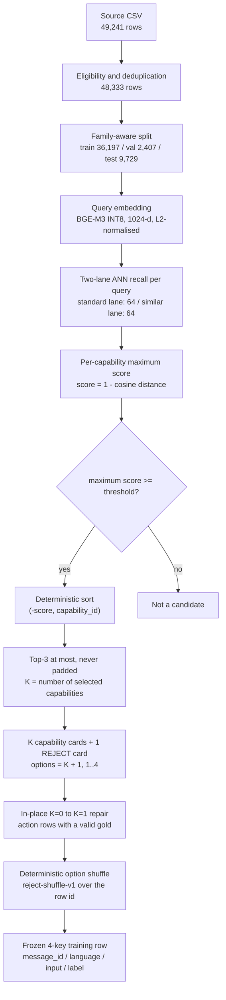

# LayaChoice V4 data versions

> **Dataset download:** [**eric-ml-nlp/Delveta-LayaChoice-v2-Data**](https://huggingface.co/datasets/eric-ml-nlp/Delveta-LayaChoice-v2-Data)
>
> The training data is hosted on Hugging Face. This GitHub directory holds the version
> documentation, the construction chain, audits and checksum records. The per-version
> JSONL bundles are **not** stored in this directory — fetch them from the dataset repo
> linked above.

LayaChoice-v2 is a multiple-choice dataset for **capability selection**: given a user
request and a set of candidate capability cards, choose the card that should handle the
request, or choose the single `REJECT` card when no candidate is correct. It is built for
fine-tuning and evaluating a Laya-style non-autoregressive decision model.

## 1. Versions

All three versions contain the same 48,333 source queries, the same `id` and
`source_query_id` sets, the same split assignment and the same 400 calibration ids. They
differ only in the similarity threshold that decides which capabilities become candidates.

| Version | Hugging Face location | Role | Threshold |
|---|---|---|---:|
| `recall_threshold_082` | repository root (`train.jsonl`, `val.jsonl`, `test.jsonl`, `manifest.json`) | **default, formal training bundle** | 0.82 |
| `recall_threshold_085` | `data_versions/recall_threshold_085/` | historical comparison only | 0.85 |
| `recall_threshold_088` | `data_versions/recall_threshold_088/` | historical comparison only | 0.88 |

`recall_threshold_082` is the bundle used by the formal training run
(`layachoice_v2_082_r1`) and by the deployed model. `recall_threshold_085` and
`recall_threshold_088` are frozen alternatives kept for comparison; they are not alternate
training runs.

A lower threshold admits more candidates; a higher threshold admits fewer and produces more
`REJECT` labels.

| Version | Threshold | Gold = capability | Gold = `REJECT` | K=0 / 1 / 2 / 3 | Repaired K=0→K=1 | Mean K |
|---|---:|---:|---:|---|---:|---:|
| `recall_threshold_082` (default) | 0.82 | 44,201 | 4,132 | 1,056 / 18,000 / 14,955 / 14,322 | 152 | 1.880206 |
| `recall_threshold_085` | 0.85 | 44,009 | 4,324 | 1,938 / 32,460 / 10,665 / 3,270 | 603 | 1.315871 |
| `recall_threshold_088` | 0.88 | 44,061 | 4,272 | 2,664 / 41,420 / 4,036 / 213 | 2,466 | 1.037200 |

`K` counts capability cards only. `K=0` rows contain the `REJECT` card alone (one option).

## 2. Scale and splits

| | |
|---|---|
| Rows per version | 48,333 (train 36,197 / validation 2,407 / test 9,729) |
| Capabilities | 18 |
| Languages | `en` 22,053 / `zh` 20,667 / `mixed` 5,613 |
| Option count | 1 to 4 (`K + 1`) |
| Training rows | 36,197, of which 400 are held out for calibration |
| Effective gradient rows | 35,797 |
| Card view | `B_noprov` (production card without query examples and provenance) |

| Split | Rows | Share | `en` | `zh` | `mixed` | Type |
|---|---:|---:|---:|---:|---:|---|
| train | 36,197 | 74.89% | 16,499 | 15,505 | 4,193 | gradient training, minus calibration |
| val | 2,407 | 4.98% | 1,116 | 1,030 | 261 | checkpoint selection |
| test | 9,729 | 20.13% | 4,438 | 4,132 | 1,159 | final benchmark only |
| total | 48,333 | 100% | 22,053 | 20,667 | 5,613 | |

Splits are stratified by source gold label × resolved language and allocated with
family-aware indivisible units. The target is about 75/20/5, with minimum representation for
small groups:

- group size 1: all rows in train;
- group size 2: one train, one test;
- group size 3 or more: at least one validation and one test row, converging to 75/20/5 for
  large groups.

Rows from the same query family never cross splits. One split assignment is computed once
and reused by all three thresholds.

**Calibration.** The first 400 rows selected from the final post-shuffle train order (seed
`20260922`, rule `min(400, n_train // 10)`) form the calibration split. Those rows remain in
`train.jsonl` but are excluded from gradient updates, leaving 35,797 effective training
rows. `manifest.json` records both the indices and the ids. Calibration is used for
temperature fitting, not for checkpoint selection.

The test split is never used for training or checkpoint selection. Checkpoint selection uses
validation top-1 only.

## 3. Row schema

Every row has exactly four keys. This is the same contract the training adapter enforces
(`ROW_KEYS` in `layachoice_v2_dataset.py`).

| Key | Type | Meaning |
|---|---|---|
| `message_id` | string | Stable row id |
| `language` | string | Resolved language: `en`, `zh` or `mixed` |
| `input` | object | Model input: `{"query": string, "options": list[string]}` |
| `label` | integer | Index of the correct option in `input.options` |

`input.query` is the user request. `input.options` is the shuffled option list in its stored
order; each element is `"<capability_id>: <card text>"`, or the bare `<capability_id>` when
the card is empty. The adapter splits each string back into the capability id (`order`) and
the card text (`options`), so the model input is `{state, order, options}`.

`label` is a scalar target index, not a one-hot vector. It may point at the `REJECT` option.

Two invariants hold for every row:

1. `0 <= label < len(input.options)`; option counts are 1–4 (K selected capabilities plus
   exactly one `REJECT`).
2. Exactly one option is `REJECT`; its rendered text is the frozen `REJECT` card.

Row-level construction metadata (`source_query_id`, `gold_capability_id`, `shuffle`,
`src_sha`, …) exists only in the construction workspace, not in the published rows.
Calibration indices and K+1 bounds live in `manifest.json`.

`input.options[label]` is the gold option: a capability card for a capability row, the
`REJECT` card for a reject row. The stored order is the **shuffled** order; it does not
encode retrieval rank.

The full field contract and validation rules are in
[DATASET_SCHEMA.md](https://huggingface.co/datasets/eric-ml-nlp/Delveta-LayaChoice-v2-Data/blob/main/DATASET_SCHEMA.md)
in the dataset repository.

## 4. Construction pipeline

The construction reuses the production card renderer and the production recall SQL shape,
and deliberately disables production capability-availability filters so that all 18
capabilities participate.



Construction order matters: the split is assigned **before** embeddings and recall, and the
same split is reused by all thresholds. Thresholds are applied **after** recall, to the
per-capability maximum scores, so the three versions do not re-run retrieval.

**Vector recall.** Queries are embedded with the frozen profile
`eric-ml-nlp/Delveta-BGE-M3-v1#INT8` through the TEI service: 1024 dimensions,
L2-normalized. Recall uses the same two-lane shape as the production retriever:

| Lane | Corpus table | Pool per query | Score |
|---|---|---|---:|
| standard | `capability_standard_queries` | 64 | `1 - cosine_distance` |
| similar | `capability_similar_queries` joined to its standard query | 64 | `1 - cosine_distance` |

The ANN index is approximate (HNSW), not an exhaustive exact-cosine scan. Hits are stored at
or above an evidence floor of 0.80; every published threshold is at least 0.82, so the floor
cannot change the candidate sets in this release. Business filters (`enabled`, `status`,
`intent_kind`, UI visibility) are intentionally **not** applied: all 18 capabilities,
including `cap-research`, participate.

**Thresholding and aggregation.** All hits from both lanes are reduced to one maximum score
per capability. A capability becomes a candidate when `max_score >= threshold` (inclusive).
Candidates are sorted by `(-score, capability_id)` and the first three are kept:
`K = len(top3)`, `options = K capability cards + 1 REJECT card`. There is no padding.
`OPTION_SLOTS = 4` is only the adapter's upper bound.

**Labels and `REJECT`.** Every row contains exactly one frozen `REJECT` card. Label
precedence:

| Condition | Label | `target_kind` | Provenance (audit only) |
|---|---|---|---|
| Source row is No-Action | `REJECT` | `reject` | `no_action` |
| `K = 0` | `REJECT` | `reject` | `no_candidates` |
| Source gold capability is in Top-3 | that capability | `capability` | `gold_in_candidates` |
| Gold is valid but not in Top-3 | `REJECT` | `reject` | `gold_not_retrieved` |

**In-place K=0 → K=1 repair.** Source action rows whose gold is valid but which had no
candidate above the threshold would otherwise have a single `REJECT` option with no
capability to learn from. The official repair injects the source gold capability as the only
capability candidate: `K=1`, `options=2`, order `[gold capability, REJECT]`, shuffled with
seed prefix `k0-to-k1-inplace-v1:<threshold>:<split>`. The audit marks the injected
candidate as `candidate_origin = "source_gold_injected"`; no retrieval score exists for it.
Post-repair, every remaining `K=0` row is a source No-Action row.

**Language resolution.** An explicit `zh` or `en` source value is kept; otherwise the query
script is inspected. Han only → `zh`, Latin only → `en`, Han plus Latin → `mixed`; mixed and
unknown are never folded into `zh` or `en`.

## 5. Leakage protection

| Risk | Protection |
|---|---|
| The evaluation query is also a retrieval-corpus query | Exclude source rows whose normalized text equals a standard or similar corpus query (908 excluded: 36 standard, 872 similar) |
| Paraphrased members of one family cross splits | Assign whole query families to one split; families are indivisible units |
| The card view names the answer | Store the `B_noprov` view: `query examples:` and the `evidence:` provenance line are removed |
| The model learns a slot prior | Shuffle all `K + 1` options per row with a deterministic row-keyed seed |
| Retrieval rank leaks through option order | Store only the shuffled `order`; scores and ranks are not training fields |
| Test data influences training or model selection | Training and selection read validation only; test is benchmark-only |
| Calibration rows receive gradient updates | Exclude the frozen 400 calibration rows from the effective train set |

The published JSONL files were checked for cross-split overlap by `id`, `source_query_id`,
exact `state`, normalized `state` and the construction query-family heuristic: no overlap
was found. There are 48,333 unique normalized queries and 36,621 unique family signatures
across the release.

Limitation: the source has no parent/derived-record id, so corpus overlap can only be
detected by exact or normalized text equality. The dataset does not prove that no semantic
paraphrase of a corpus query exists.

## 6. Getting the data

The dataset repository is
[**eric-ml-nlp/Delveta-LayaChoice-v2-Data**](https://huggingface.co/datasets/eric-ml-nlp/Delveta-LayaChoice-v2-Data).
Pin a revision for reproducible runs.

### Default bundle (082) — flat layout

The repository root is the flat `recall_threshold_082` bundle
(`manifest.json` plus `train.jsonl`, `val.jsonl`, `test.jsonl`), the file layout
`run.sh` expects at `V2/data/`. The rows use the four-key training schema
(`message_id`, `language`, `input`, `label`), which the current adapter accepts.

```bash
python - <<'PY'
from huggingface_hub import snapshot_download

snapshot_download(
    repo_id="eric-ml-nlp/Delveta-LayaChoice-v2-Data",
    repo_type="dataset",
    allow_patterns=["train.jsonl", "val.jsonl", "test.jsonl", "manifest.json",
                    "SHA256SUMS", "README.md", "DATASET_SCHEMA.md", ".gitattributes"],
    local_dir="fine_tuning/laya_finetune/V2/data",
)
PY
```

This downloads `manifest.json`, `train.jsonl`, `val.jsonl`, `test.jsonl`, `SHA256SUMS`
and the dataset card files, without the historical `data_versions/` trees. Training reads
only the manifest and the three splits.

### Historical versions (085 / 088)

Download one version into its own flat directory and pass it with `--data`:

```bash
python - <<'PY'
from huggingface_hub import snapshot_download

for version in ("recall_threshold_085", "recall_threshold_088"):
    snapshot_download(
        repo_id="eric-ml-nlp/Delveta-LayaChoice-v2-Data",
        repo_type="dataset",
        allow_patterns=[f"data_versions/{version}/*"],
        local_dir=f".local-data/{version}",
    )
PY
mv .local-data/recall_threshold_085/data_versions/recall_threshold_085/* .local-data/recall_threshold_085/
rm -rf .local-data/recall_threshold_085/data_versions
```

Repeat for 088, or keep the nested layout and pass the inner directory directly. Verify a
downloaded bundle with the bundled checksums:

```bash
cd .local-data/recall_threshold_085 && sha256sum -c SHA256SUMS
```

The Hugging Face bundles use `train.jsonl` / `val.jsonl` / `test.jsonl`. The archived
working-copy layout under `data_versions/recall_threshold_0XX/` on a construction machine
uses `v2_train.jsonl` / `v2_val.jsonl` / `v2_test.jsonl`; see §8 for the difference.

## 7. Manifests and checksums

Each Hugging Face bundle carries its own `manifest.json` (split sizes, calibration indices
and ids, option contract, base revision) and `SHA256SUMS`. The dataset repo is the source of
truth for downloaded bytes.

| Version | Manifest | Checksum file |
|---|---|---|
| 082 (root) | [manifest.json](https://huggingface.co/datasets/eric-ml-nlp/Delveta-LayaChoice-v2-Data/blob/main/manifest.json) | [SHA256SUMS](https://huggingface.co/datasets/eric-ml-nlp/Delveta-LayaChoice-v2-Data/blob/main/SHA256SUMS) |
| 085 | [manifest.json](https://huggingface.co/datasets/eric-ml-nlp/Delveta-LayaChoice-v2-Data/blob/main/data_versions/recall_threshold_085/manifest.json) | [SHA256SUMS](https://huggingface.co/datasets/eric-ml-nlp/Delveta-LayaChoice-v2-Data/blob/main/data_versions/recall_threshold_085/SHA256SUMS) |
| 088 | [manifest.json](https://huggingface.co/datasets/eric-ml-nlp/Delveta-LayaChoice-v2-Data/blob/main/data_versions/recall_threshold_088/manifest.json) | [SHA256SUMS](https://huggingface.co/datasets/eric-ml-nlp/Delveta-LayaChoice-v2-Data/blob/main/data_versions/recall_threshold_088/SHA256SUMS) |

Frozen bundle checksums at revision
`e913457be250c3ebb0e1989f4e74ee25a0d36688` of the Hugging Face repository:

| File | 082 (default) | 085 | 088 |
|---|---|---|---|
| `train.jsonl` | `97ed1b54a205d3fac4dd3837e93abb779104568b94019c9a161752c7ca670c77` | `eca109f5a12abf929dcf5496235d602252357780e6144331b05c562afe71e3be` | `628241c3a2688da4957c97a3dac3358948195e08982a7c644332c6f9b4d5fd27` |
| `val.jsonl` | `833829ce30d929a8ce502036e3f7b049ef8279770558a632efaaf6bd9e54cb03` | `890c0c4a456e1c9d4ed03e12c7d8fbbb95364c00640fb83bf2ee262be022ea01` | `cf2b87c608293faae065c5256f056fe8cbe924f8161e5ee5c8beb56c0abc9d6b` |
| `test.jsonl` | `66c6318d57d2021a85384020f8fb52f5903f37353ec7593e3e6b07c6215dbac1` | `1977742fe562415fbfb6dc76f2dceb9a81ba0d737e6bf6caec18beed698a2dcd` | `203dc715d79247c46476b63288cb0b453c7ec33cb9c94691699533509c76fac6` |
| `manifest.json` | `92514b46c1e090d50bcae9464112aa80ad8ba48f4e929f098afb929d7488adf8` | `7443cc774fce07319068497848f762cb5639cc5e15e98ffe1e4a8b7a4b95ea70` | `dd12efeb315c1bcfd9a7a1ba1aeafb1ced57416e6c01e40ee3df85d9169a5395` |

[SHA256SUMS.all_thresholds](SHA256SUMS.all_thresholds) in this directory is a different
record: it covers the construction workspace copies (`recall_threshold_0XX/v2_*.jsonl`,
construction audits, `direct_reject.jsonl` and `shared/` artifacts). Those files are not the
Hugging Face release and are not distributed with this repository.

## 8. Training-code data contract

The training code is not changed by this document. Its current contract:

- [layachoice_v2_dataset.py](../V2/layachoice_v2_dataset.py) defines
  `DATA = <V2>/data` as the default bundle root. It reads `manifest.json` and
  `{split}.jsonl` (falling back to `v2_{split}.jsonl`).
- [run.sh](../V2/run.sh) defaults to `DATA="$HERE/data"` and accepts `--data DIR` on every
  stage (also `--python EXE` and `--out DIR`).
- [layachoice_v2_verify.py](../V2/layachoice_v2_verify.py) detects two layouts:
  - **flat**: `manifest.json` at the bundle root;
  - **dynamic**: `recall_threshold_082/`, `recall_threshold_085/` and
    `recall_threshold_088/` side by side, read from the parent
    `SHA256SUMS.all_thresholds`. This is the construction-workspace archive layout, with
    `v2_*.jsonl` file names.

**Schema.** The adapter validates exactly four row keys (`message_id`, `language`, `input`,
`label`) and requires the manifest's `training_schema_keys` to name the same four keys. The
Hugging Face bundles use this same four-key schema, and their `manifest.json` lists the same
four keys, so the release is directly readable by the current training and verification
code.

Practical consequences:

- The default entry point expects a flat bundle at `V2/data/`. The Hugging Face root bundle
  matches that layout and can be downloaded there directly (§6).
- Checksums of a downloaded bundle can be checked with `sha256sum -c SHA256SUMS`.
- A historical version can be pointed at with `--data`; it uses the same schema.
- The dynamic archive layout is **not** byte-compatible with the Hugging Face bundles
  (different file names and different bytes). Do not mix a Hugging Face download into a
  `recall_threshold_0XX/` directory that is covered by `SHA256SUMS.all_thresholds`.
- `message_id_map.jsonl` and the `shared/` retrieval intermediates are local audit material.
  Training never reads them.

## 9. Limitations

1. **No human-confirmed No-Action.** The 3,000 source no-action rows are either
   `rule_checked_pending_human_review` (2,000) or `synthetic_needs_validation` (1,000). They
   are not human-confirmed real user refusals.
2. **Synthetic and rebuilt source material.** The source combines rebuilt, query-list and
   synthetic records; it is not a sample of production traffic.
3. **Approximate retrieval.** Recall uses an HNSW ANN index with a 64-row pool per lane, not
   exact cosine search.
4. **Only exact/normalized leakage is excluded.** No parent/derived-record id exists in the
   source, so paraphrased or derived corpus queries may remain.
5. **Not every production capability filter is modeled.** All 18 capabilities participate,
   including `cap-research`.
6. **Language labels are partly derived.** 29,241 source rows have a blank `language` field
   and are resolved from script; `mixed` is kept as its own class.
7. **Threshold is a design choice.** The default 0.82 is the installed training bundle, not
   a statement that 0.82 is universally optimal. 0.85 and 0.88 are frozen alternatives with
   materially different candidate distributions.
8. **The test split is a fixed benchmark, not a fresh holdout.** It is frozen for this
   benchmark and should not be treated as an untouched held-out set for repeated model
   development.

## 10. Related files in this repository

| Path | Purpose |
|---|---|
| [SHA256SUMS.all_thresholds](SHA256SUMS.all_thresholds) | Checksums of the construction-workspace copies (not the Hugging Face release) |
| [dataset_construction/README.md](dataset_construction/README.md) | Construction bundle: layout, reproduction status and gaps |
| [dataset_construction/BUILD_RECORD.md](dataset_construction/BUILD_RECORD.md) | Build record, source lineage and known reproduction gaps |
| [dataset_construction/full_r1/](dataset_construction/full_r1/) | Construction entry, generation log and build reports |
| [dataset_construction/repair/](dataset_construction/repair/) | Official K=0 → K=1 repair and verification scripts |
| [dataset_construction/audit/](dataset_construction/audit/) | Read-only statistics, schema, parity and coverage audits |
| [dataset_construction/inventory/](dataset_construction/inventory/) | File-level SHA-256 inventories of the construction chain |
| [build/](build/) | Capture, generation, repair and card-refresh scripts |
| [smoke/](smoke/) | Smoke-fixture builder and driver |
| [audit/prompt_parity_audit.md](audit/prompt_parity_audit.md) | Prompt/rendering parity audit |
| [shared/capability_ids.json](shared/capability_ids.json) | The 18 capability ids |

Training recipe and run record: [V2/README.md](../V2/README.md).

## 11. License and citation

**License.** The Delveta repository code is licensed under the GNU Affero General Public
License v3.0. No separate license has been declared for this dataset content. This document
does not grant a dataset license; until the maintainer declares one, do not assume that the
data may be redistributed or used commercially. The source data's own terms also apply.

**Citation.** There is no associated paper, DOI or formal citation for this dataset. If a
reference is required, cite the dataset name and the exact version or revision used:

```text
Delveta. Delveta-LayaChoice-v2-Data. Version recall_threshold_082 (or the specific
threshold directory), <revision>.
```

Do not cite a paper that does not exist. The frozen checksums in each bundle's
`SHA256SUMS` identify the exact data bytes used in an experiment.
